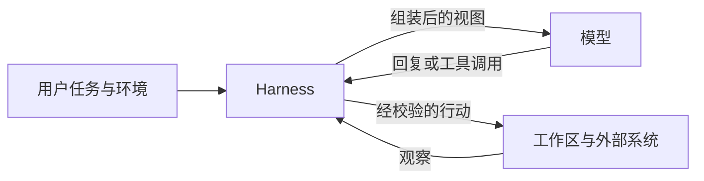
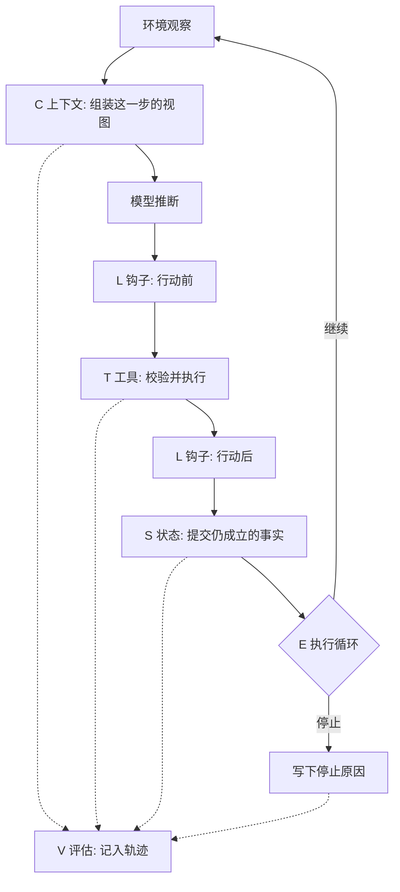
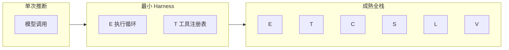
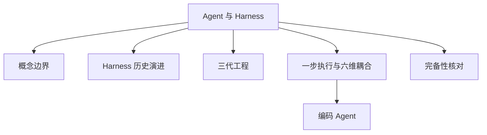

# Agent 与 Harness 基本原理

> **一句话总结**：Agent 是模型加上 Harness。模型负责下一次推断；Harness 是包在外面的运行时。本仓库把六个维度 \(H = (E, T, C, S, L, V)\) 用作 Agent Harness 产品的质量与成熟度评估框架：逐维看已经具备、只部分具备，还是仍要调用方补齐。

本文遵循本仓库的设计原则：**先讲清「为什么」，再讲「怎么做」**，并标明关联、边界与可核对的证据。

- 适用前提：六维的原始定义来自 Meng 等的预印本（2026-04-28 挂出的 v3，页面标明尚未同行评审）[1]。作者仓库另提供 PDF，其中包含更新的 v4，引用分数前应核对你打开的版本 [2]。模型与 Harness 的分工采用 LangChain 2026-03-10 的表述 [3]。字母冲突对照 Li 等的 ETCLOVG 项目页 [4]。编码产品中的循环形态参考 OpenAI 对 Codex 循环的说明（2026-01-23）[5]。**脱离模型标识、工具格式、隔离级别和实验设置的成熟度结论不能直接搬用。**

---

## 1. 它为什么存在

### 1.1 一次模型调用覆盖不了多步工作

语言模型的基本契约是：接收文本、图像或其他模态，输出下一段内容 [3][5]。聊天产品之所以像一场持续的对话，是因为外层有一个循环：保存已经发生的消息，把新的用户输入追加进去，再调用一次模型 [3]。这个循环本身就是一层很薄的 Harness。

多步工作还要求模型单独做不到的事。LangChain 的解剖文章列出四项：跨交互保持耐久状态、执行代码、取得训练截止之后的信息、为完成工作准备环境和依赖 [3]。这些都要由模型外面的代码、配置和执行逻辑实现。同一篇文章给出的操作定义是：Agent = Model + Harness；如果你不是模型，你就是 Harness [3]。

因此「换一个更强的模型」和「把运行时补齐」是两件不同的工程。模型变强可以提高单次判断的质量。停止条件、工具是否按模式执行、崩溃后从哪份状态恢复，仍然由 Harness 决定 [1][6]。

### 1.2 同一模型、不同运行时，成绩会移动

Meng 等把这类现象收成一个判断：可靠性越来越取决于包住模型的 Harness，而不只取决于模型本身 [1]。他们在图 4 汇总了若干「模型保持不变、只改 Harness」的公开报告，其中包括：编辑工具的格式变化使 xAI Grok Code Fast 1 在 SWE-bench 上从 6.7% 升到 68.3%；LangChain DeepAgents 在 TerminalBench 上从 52.8% 升到 66.5%；自动优化的 Meta-Harness 在 Terminal-Bench 2 上达到 76.4% [1]。这些数字来自不同实验，不能排成一张统一榜单。它们共同支持的窄结论是：公开分数描述的是「某个模型在某个 Harness 里」，不是模型的裸能力。

LangChain 还报告，仅更换 Harness，就把自己的编码 Agent 在 Terminal-Bench 2.0 上的名次从大约前 30 推进到前 5；并称 Claude Opus 4.6 放在 Claude Code 里的成绩，明显低于同一模型放在其他 Harness 里的成绩 [3]。技能注入也不是单调增益。综述引用 SkillsBench 的初步结果：技能管理基础设施对应约 16.2 个百分点的平均变化，同时 86 个任务里有 16 个是负向的；综述自己把这标成尚待同行评审确认的证据 [1]。

所以评估一个 Agent 产品时，要同时写下模型标识和 Harness 版本。只报模型名字，成熟度无法解释。

### 1.3 六个维度各自挡住一类事故

综述把六个职能和六类反复出现的生产事故对齐 [1]：

| 维度 | 综述中的运行时职能 [1] | 缺了它时常见的事故 |
| --- | --- | --- |
| \(E\) 执行循环 | 观察—思考—行动的回合、终止和错误恢复 | 停不下来，或过早宣布完成 |
| \(T\) 工具注册表 | 有类型、可校验的工具目录，以及调用的路由和监视 | 参数不合法，或行动打到错误的效应器 |
| \(C\) 上下文管理 | 每一步进入窗口的信息：压缩、检索、优先级 | 窗口被灌满，关键约束丢失 |
| \(S\) 状态存储 | 跨回合、必要时跨会话的任务状态和失败恢复 | 中断后无从恢复，或恢复到错误版本 |
| \(L\) 生命周期钩子 | 调用前后的鉴权、审计、策略和插桩 | 副作用没有第二道关，规则只写在提示里 |
| \(V\) 评估接口 | 可供外部程序消费的轨迹、中间状态和成功信号 | 只能看到最终一句话，无法比较两次运行 |

本仓库用同一组维度做**质量与成熟度评估**：对一个具体产品，每一维只填三档之一。

| 档位 | 含义 |
| --- | --- |
| 已具备 | 运行时自己执行该维，并有生产所需的失败处理 |
| 部分具备 | 有相关机制，但覆盖、恢复或记录不完整 |
| 调用方补齐 | 库或产品没有做，部署者必须自己补，否则该维缺失 |

六维都达到生产所需的可靠性，才记为成熟的全栈 Harness [1]。只做了其中几维，是部分治理，不是不及格的同义词：它说明这个产品把哪些决策留给了调用方。

---

## 2. 模型与 Harness 如何分工

### 2.1 一次推断里两边各做什么



左到右是一次行动的方向。模型不直接改仓库、不直接扣款、也不直接决定进程死了以后从哪继续。它输出下一段内容或一次结构化的工具调用 [5]。Harness 决定这段输出里哪些会变成真实副作用，以及下一步把什么送回模型 [1][3]。

编码 Agent 里，这个分工特别明显。OpenAI 对 Codex 循环的说明是：一次用户回合可以包含许多次「推断—工具」迭代；当模型不再发出工具调用、而交出给用户的消息时，循环把这当作终止信号 [5]。有意义的产出却常常是工作区里的补丁，不是那句收尾。收尾消息证明循环停了，不证明测试通过。测试是否运行、失败后是否继续，是 Harness 的终止条件。

### 2.2 哪些东西算 Harness

LangChain 把 Harness 写成模型之外的全部代码、配置和执行逻辑，并举出这些具体内容 [3]：

- 系统提示，以及仓库入口一类会在启动时注入的指令；
- 工具、技能、MCP 服务器，以及它们的描述；
- 随身的基础设施：文件系统、沙箱、浏览器；
- 编排：生成子代理、交接、模型路由；
- 为了确定性执行而设的钩子或中间件：压缩、续跑、lint。

提示词因此不是 Harness 外面的另一种手艺。它是上下文这一维里的一层材料。上下文工程决定这一步看见什么；Harness 工程还要决定行动如何被执行、提交、拦截和记录 [4]。三代关注面的展开留在索引中的「三代工程」。

### 2.3 和相邻词的最小分界

综述用一张表把容易混用的对象分开。这里只保留和「模型 / 运行时」直接有关的四行，完整的平台、Agent OS 与评估设施对照留在「概念边界」[1]。

| 对象 | 它回答的问题 | 和 Agent 的关系 |
| --- | --- | --- |
| 语言模型 | 下一段内容是什么 | Agent 的被调用者 |
| 框架 / SDK | 开发时用哪些原语组装 | 可以生成 Harness，也可以只提供零件 [1][6] |
| Harness | 这次任务在运行时如何被管住 | 使模型表现为多步 Agent 的那一层 [1][3] |
| 评估设施 | 行为如何被批量测量 | 重点实现测量，不一定带生产用的工具和状态 [1][6] |

Arize 的分层和上表一致：模型回答「下一步说什么或做什么」；框架回答「开发者如何组装」；Harness 回答「工作如何安全、持久地执行」；追踪回答「发生了什么」；评估回答「是否可接受」[6]。一个代码库可以同时包含框架和一套意见明确的 Harness。分类时看运行时决策落在哪，不看仓库名字。

综述还转述：Anthropic 内部用 scaffold 指「让模型以 Agent 方式运转的系统，负责处理输入、协调工具调用并返回结果」[1]。本仓库把 scaffold 当作 Harness 的近义词。该句的原始出处是综述的参考文献 [65]，不是本篇独立核对过的 Anthropic 文档；使用时以综述的转述为限 [1]。

---

## 3. 用 \(H\) 评估成熟度

### 3.1 六个维度

Meng 等给出的形式是一个六元组 [1]：

$$
H = (E, T, C, S, L, V)
$$

他们的定义是六个**运行时治理职能**，动机是三类需求，不是随意编号 [1]：

- \(E\) 与 \(T\) 面对外部世界：怎样一步步跑，以及怎样动手；
- \(C\) 与 \(S\) 面对模型的信息：这一跳看见什么，哪些事实留得下来；
- \(L\) 与 \(V\) 面对问责：规则在边界上执行，行为能被事后判定。

本仓库把这六个职能用作产品质量和成熟度的评估维度。评估问的是「这个产品在该维上做到了哪一档」，不是「团队有没有写过一个同名模块」。一个叫 Memory 的类如果只是把对话追加进数组，状态维仍是部分具备：崩溃后的恢复点和副作用是否对齐，还没有被运行时保证。

\(L\) 和 \(V\) 都跟「记录」有关，评估时必须分开 [1]：

- 钩子为了控制。它能证明某次调用被拒绝或被要求批准。
- 评估接口为了判定。它要以稳定模式交出行动类型、参数、结果、中间状态、完成信号和每步消耗，让另一套程序可以直接比较轨迹。

只有操作日志时，成熟度表上的 \(L\) 可以是已具备，\(V\) 仍是部分具备或调用方补齐。HAL 一类评估设施要求的是后一种记录 [1]。

### 3.2 一步执行怎样穿过六个维度



从左到右、从上到下是时间。虚线是旁路记录，不代替实线的控制。对照一个具体产品时，沿这张图问八个问题，就能填成熟度表：

1. 停止原因有哪些，工具抛错时循环走到哪？这是 \(E\)。
2. 未知工具名、缺字段和类型错误会被拒绝，并作为观察返回吗？这是 \(T\)。
3. 目标、计划和工具结果谁在超预算时被留下，谁被外置？这是 \(C\)。
4. 进程死在工具执行中途，重启后会不会把同一副作用做第二次？这是 \(S\)。
5. 高权限行动在执行前是否一定经过批准或策略，且不依赖模型同意？这是 \(L\)。
6. 导出的记录能否让外部程序读到参数、结果、停止原因和策略版本？这是 \(V\)。

后两问若答不上，不要先换模型。缺的是评估维度，换模型不会把轨迹字段变出来 [6]。

### 3.3 最小形态与完整形态

综述给出两条线 [1]：

- **最低条件是 \(E\) 和 \(T\)。** 没有多步循环，系统是单次推断的包装。没有工具，系统是没有效应器的推理引擎。二者齐备，才有可治理的多步行动，才进入 Harness 的讨论范围。
- **充分条件是六维都以生产所需的方式实现**，包括错误处理、身份、可观察性和写明的失败模式。这是成熟的全栈 Harness。



中间地带是常态。框架常常把 \(E\) 和 \(T\) 交给应用作者，\(C\)、\(S\)、\(L\)、\(V\) 由部署者补 [1]。补到哪一档，产品就成熟到哪一档。

任务会把「可调用方补齐」变成「必须已具备」，而且这种上升不是线性的。综述的任务表可以当成压力尺 [1]：

| 任务 | \(E\) | \(T\) | \(C\) | \(S\) | \(L\) | \(V\) |
| --- | --- | --- | --- | --- | --- | --- |
| 单轮问答 | 低 | 可无 | 低 | 可无 | 可无 | 可选 |
| 多步检索 | 中 | 搜索与浏览 | 高 | 弱 | 弱 | 可选 |
| 软件修改 | 高 | 文件、命令、测试 | 高 | 必需 | 必需 | 必需 |
| 长期助理 | 高 | 宽 | 高 | 必需 | 必需 | 上线后变必需 |
| 多代理协作 | 高 | 宽，含对其他执行者的调用 | 高 | 必需 | 必需 | 必需 |
| 具身或 GUI | 高 | 传感与执行器 | 中 | 必需 | 必需 | 必需 |

软件修改把六列都推高，是因为工作区就是状态，测试就是完成信号，命令就是高权限效应器。一个编码产品若在 \(S\) 或 \(L\) 上仍是「调用方补齐」，它更接近带工具的对话，哪怕界面叫 Agent。分界看的是这两维在不在运行时里，不看模型会不会写计划 [1]。

### 3.4 另一套字母

Li 等的 ETCLOVG 按工程表面切成七层：执行环境、工具、上下文、生命周期与编排、可观测性、验证、治理 [4]。前四层是结构核心，后三层是控制面。他们明确把这套切法和 Meng 等的六职能对照，并指出可观测性与治理被单列，是因为生产里这两块常常有独立工具和负责人 [4]。

同字母不是同一层。读后文时以中文名称为准：

| 字母 | 本仓库的 \(H\)：成熟度维度 [1] | ETCLOVG 中的同字母 [4] |
| --- | --- | --- |
| \(E\) | 执行循环 | 执行环境：沙箱、微虚拟机、浏览器 |
| \(T\) | 工具注册表 | 工具接口与协议，两者接近 |
| \(C\) | 当步上下文 | 上下文加记忆，横跨视图和持久层 |
| \(L\) | 调用前后的拦截钩子 | 生命周期加编排 |
| \(V\) | 标准化轨迹接口 | 验证与评估，范围更宽 |

\(S\) 只属于本仓库这套六维。ETCLOVG 没有单独的 \(S\)，持久化主要落在他们的上下文与生命周期层 [4]。环境、观测、治理、编排在本仓库是六维在部署中的落点，不是第七到第十个评分维度。

---

## 4. 边界与代价

### 4.1 适用

用 \(H\) 做评估，适合这些问题：

- 选型：这个框架是零件，还是已经带了一套可运行的 Harness；
- 排障：失败先落在哪一维，再决定改提示、改工具模式，还是改提交点；
- 读榜：分数是否同时绑定了模型、Harness 和环境 [1][3][6]。

六维能分维打分，是为了让缺口可见。综述同时写明，实现里它们是耦合的：循环怎样恢复，取决于状态在失败前提交了什么；上下文放进什么，要经过钩子才知道哪些内容被允许；评估能问的问题，被前面的记录决策封顶 [1]。只把 \(E\) 从「部分具备」改成「已具备」，而提交点仍和副作用对不齐，成熟度表会在 \(S\) 上继续暴露同一事故。

### 4.2 不适用

- **不能代替模型能力判断。** 六维都已具备的产品，仍会在模型不会做的推理上失败。此时证据应当是：工具参数合法、上下文里约束还在、停止原因是任务本身无解，而不是运行时提前退出 [6]。
- **不能把「有一个循环」记成 \(E\) 已具备。** 综述用带标签的转移讨论执行循环：错误事件也必须能走到终止，并且要有步数、时间或费用一类出口 [1]。只有「进行中 / 模型说完了」两个状态的 `while`，是循环这一模式的种子。它还没有错误弧和预算。
- **不能把聊天记录记成 \(S\) 已具备。** 状态要回答的是：副作用完成之后，哪份检查点成为下一轮的事实。只追加消息，压缩或重启之后就会和磁盘不一致 [1][5]。
- **不能把框架的图编辑器记成全栈。** 图可以规定控制流，同时把压缩、批准和轨迹留给调用方。那些空着的维应填「调用方补齐」[1]。
- **分数不能跨实验相加。** 第 1.2 节的百分比来自综述对公开报告的汇总 [1] 和 LangChain 自己的博文 [3]。工具格式、基准版本和是否允许特定脚手架都变了，就不能把两个百分点写成同一次改进。

### 4.3 代价

把六维都做到生产档，会付出这些代价：

| 代价 | 它换来什么 | 过了头会怎样 |
| --- | --- | --- |
| 每步都做模式校验和批准 | 高权限行动有第二道关 | 批准频繁到人无法看，政策会被整个关掉 |
| 上下文预算和压缩 | 长任务还能继续 | 摘要若吃掉目标和已批准的决定，\(C\) 的得分上升、任务反而失败 |
| 检查点与幂等 | 崩溃后不重复副作用 | 对已经发出的邮件、付款，检查点只能记录补偿信息，不能假装世界可以还原 [1] |
| 结构化轨迹 | 失败可以回归 | 轨迹里会有提示、仓库片段和秘密，采集必须同时规定屏蔽和保留期 [6] |
| 固定工具格式 | 模型和工具契约对齐，成绩稳定 | 换一种等价格式可能明显掉点，因为模型可能在原格式上训练过 [1][3] |

模型继续变强，会减少今天写在提示里的计划提醒 [3]。环境里有什么工具、谁必须批准、完成信号从哪来，这些评估维度不会因此消失。成熟度表要随模型、协议和产品版本重填，这是本仓库「持续演进」原则在这一篇上的含义。

---

## 5. 可验证：给一个产品填表

下面的脚本不运行 Agent。它检查你根据轨迹和配置填入的证据，是否足以把某一维写成「已具备」。取值只允许 `present`、`partial`、`caller`。这是教学用的核对器，不是生产评分服务。

```python
DIMENSIONS = {
    "E": "执行循环",
    "T": "工具注册表",
    "C": "上下文管理",
    "S": "状态存储",
    "L": "生命周期钩子",
    "V": "评估接口",
}

# 每一维至少要能指出的证据。答不上来，就不能填 present。
REQUIRED_EVIDENCE = {
    "E": "停止原因包含完成、预算和工具错误三条不同的转移",
    "T": "非法参数被拒绝，并且拒绝文本会回到下一步",
    "C": "超预算时目标和未完成计划仍以结构化字段存在",
    "S": "工具副作用完成后才写检查点，写操作有幂等键",
    "L": "高权限工具在执行前经过钩子，钩子不依赖模型同意",
    "V": "导出记录含行动、参数、结果、停止原因和策略版本",
}


def grade(levels: dict[str, str], evidence: dict[str, str]) -> None:
    allowed = {"present", "partial", "caller"}
    missing = [k for k in DIMENSIONS if k not in levels]
    if missing:
        raise SystemExit(f"缺维度: {missing}")
    for key, level in levels.items():
        if level not in allowed:
            raise SystemExit(f"{key} 的档位无法识别: {level}")
        if level == "present" and not evidence.get(key, "").strip():
            raise SystemExit(f"{key} 标成已具备，但没有证据。需要: {REQUIRED_EVIDENCE[key]}")
    ready = [k for k, level in levels.items() if level == "present"]
    print("已具备:", [DIMENSIONS[k] for k in ready])
    print("尚未全栈:" , [DIMENSIONS[k] for k in DIMENSIONS if k not in ready])
    print("进入 Harness 讨论范围:", levels["E"] != "caller" and levels["T"] != "caller")


# 一个只包了循环和工具、其余留给应用的框架，可以这样填。
grade(
    levels={"E": "partial", "T": "present", "C": "caller", "S": "caller", "L": "caller", "V": "caller"},
    evidence={"T": "工具调用有 JSON Schema，校验失败会返回给模型"},
)
```

用它看自己的编码 Agent 时，按第 3.2 节的六个问题各写一句证据。脚本拒绝「已具备但证据为空」。这只核对你有没有写下证据，不核对证据是否真实；真实与否仍要打开那次运行的轨迹 [6]。

再做一个更小的行为核对，不需要脚本：

1. 让一个写文件的工具失败一次。系统是把错误交回模型、重试，还是把半成品当成已提交？后一种对应 \(E\) 与 \(S\) 都还不是已具备。
2. 把一条应当被拒绝的高权限命令交给它。拒绝若只发生在提示里的「请不要」，\(L\) 填调用方补齐。
3. 导出最近一次失败。若导出里没有停止原因和工具参数，\(V\) 至多是部分具备。

---

## 6. 关联：它在知识网络中的位置



- **与概念边界**：本篇只划开模型、框架、Harness 和评估设施。平台、Agent OS，以及 ETCSLV / ETCLOVG 的完整对照，在索引的「概念边界」。
- **与 Harness 历史演进**：六维不是一次头脑风暴的产物。测试包装、强化学习的 `reset` / `step` 契约、早期 Agent 暴露的失败类型，是这组维度的历史来源 [1]。细节在索引的「Harness 历史演进」。
- **与三代工程**：提示词是上下文的一层，上下文是 Harness 的一部分。Li 等把这个扩张写成提示词工程、上下文工程、Harness 工程 [4]。
- **与运行时各篇**：本篇的六问是入口。执行循环、工具、上下文、状态、钩子、评估各有独立主题，索引在仓库 `README.md` 的「运行时」。
- **与完备性核对**：第 5 节的三档填写，就是生态索引里「完备性核对」要做的事。公开系统的全栈 / 框架 / 模块分类也用同一把尺子 [1]。
- **与编码 Agent**：软件修改是六维压力最高的常见任务 [1]。工作区、受控命令和终止前测试，是 \(S\)、\(T\)、\(E\)、\(L\) 在这个任务上的具体形态 [3][5][7]。

---

## 7. 延伸阅读

- 本仓库索引：[`README.md`](../README.md) 的「基础概念」「运行时」「生态」。相邻主题目前多数仍是提纲。
- 六维定义、最低条件和任务压力表：Meng 等预印本第 3 节 [1]，作者仓库的 PDF [2]。
- 模型 / Harness 分工和编码原语：LangChain，*The Anatomy of an Agent Harness* [3]。
- 七层工程表面：Li 等项目页 [4]。
- 一次编码循环如何开始和停止：OpenAI，*Unrolling the Codex agent loop* [5]。
- 追踪、评估和 Harness 改动的分工：Arize [6]。
- 环境规格不足时，人要补的是可读且可执行的约束：OpenAI，*Harness engineering* [7]。

---

## 参考文献

1. Meng, Q., Wang, Y., Chen, L., Li, Y., Wu, W., Jiang, W., Wang, Q., Lu, C., Gao, Y., Wu, Y., and Hu, Y. *Agent Harness for Large Language Model Agents: A Survey*. Preprints.org, manuscript 202604.0428, v3, posted 2026-04-28. 页面标明尚未同行评审。本篇的六维定义、\(E{+}T\) 最低条件、事故对照、任务压力和概念分界来自该预印本第 3 节及图 4 的汇总。链接：<https://www.preprints.org/manuscript/202604.0428>
2. Awesome-Agent-Harness. 综述作者维护的仓库，含论文 PDF（仓库中可见 v4 文件名）。分数和图表以你打开的 PDF 版本为准，不默认等于预印本 v3。链接：<https://github.com/Gloriaameng/Awesome-Agent-Harness>
3. Trivedy, V. *The Anatomy of an Agent Harness*. LangChain Blog, 2026-03-10. Agent = Model + Harness，模型单独做不到的四类工作，以及同一模型更换 Harness 后的基准移动。链接：<https://www.langchain.com/blog/the-anatomy-of-an-agent-harness>
4. Li, J., Xiao, X., Zhang, Y., et al. *Agent Harness Engineering: A Survey*. 项目页给出 ETCLOVG 七层，以及提示词、上下文、Harness 三层关注面。作者名单以项目页为准。链接：<https://picrew.github.io/LLM-Harness/> ；PDF：<https://picrew.github.io/LLM-Harness/main.pdf> ；目录仓库：<https://github.com/Picrew/awesome-agent-harness>
5. Bolin, M. *Unrolling the Codex agent loop*. OpenAI, 2026-01-23. 编码循环的推断、工具迭代、终止消息，以及上下文窗口同时计入输入和输出。链接：<https://openai.com/index/unrolling-the-codex-agent-loop/>
6. Arize. *Agent Harness: Architecture, Tracing, and Evaluation*. 模型、框架、Harness、追踪、评估的分层，以及跨度、轨迹、路径、会话四层判定。链接：<https://arize.com/resources/agent-harness-evaluation-tracing/>
7. Lopopolo, R. *Harness engineering: leveraging Codex in an agent-first world*. OpenAI, 2026-02-11. 早期进度受限于环境规格，而不是模型写不出函数。链接：<https://openai.com/index/harness-engineering/>

### 图片来源与许可声明

本文的图都是 **Mermaid 自绘**（`flowchart`），由 GitHub 在渲染 Markdown 时画出。没有从论文 PDF、博客或产品文档下载插图。Meng 等的架构图、LangChain 与 OpenAI 页面上的配图版权归各自作者或出版方，本仓库不转载；需要看原图时打开上面的链接。

| 图 | 位置 | 类型 | 说明 |
| --- | --- | --- | --- |
| 模型与 Harness 的分工 | 第 2.1 节 | Mermaid flowchart | 自绘。分工关系依据文献 [3][5] |
| 一步执行穿过六个维度 | 第 3.2 节 | Mermaid flowchart | 自绘。步骤顺序依据文献 [1] 对单步控制流的描述，不是原图复制 |
| 最小形态到成熟全栈 | 第 3.3 节 | Mermaid flowchart | 自绘。最低条件与充分条件依据文献 [1] |
| 在知识网络中的位置 | 第 6 节 | Mermaid flowchart | 自绘，对应本仓库 `README.md` 的索引结构 |

自绘图只表达本篇的结构，不表示原作者认可这张图的画法。文献 [1] 的经验数字保留在正文里并注明出处，没有重绘他们的证据矩阵。
