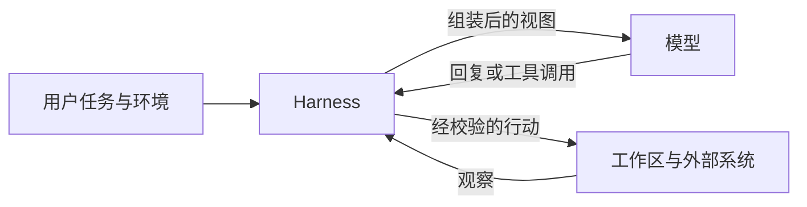
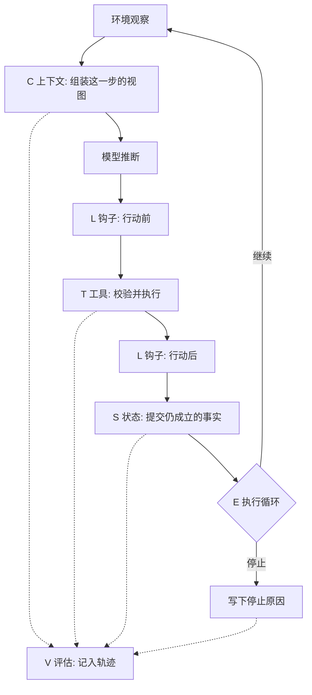
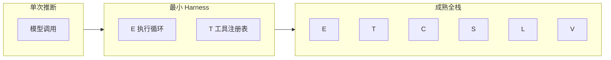
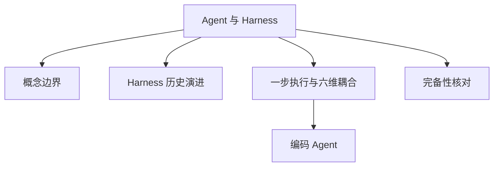

# Agent 与 Harness 基本原理

## 摘要

本文将 Agent 定义为语言模型与其运行时的组合。模型完成单次推断；Harness 负责把推断组织为多步执行，并实施工具调用、状态提交与约束。Meng 等将这一运行时形式化为六元组 \(H=(E,T,C,S,L,V)\)，分别对应执行循环、工具注册表、上下文管理、状态存储、生命周期钩子和评估接口 [1]。本仓库用该六元组作为产品质量与成熟度的评估框架：每一维标记为已具备、部分具备或由调用方补齐。六维均达到生产所需的可靠性时，记为成熟的全栈 Harness。

## 范围与材料

六维的原始定义取自 Meng 等的预印本。该文于 2026-04-28 以 v3 发布，页面标明尚未同行评审 [1]。作者仓库另提供 PDF，其中包含后续 v4；引用数值前应核对所读版本 [2]。模型与 Harness 的分工采用 LangChain 2026-03-10 的表述 [3]。与 ETCLOVG 的字母对照依据 Li 等的项目页 [4]。编码产品中的循环形态依据 OpenAI 对 Codex 循环的说明（2026-01-23）[5]。成熟度判断依赖模型标识、工具格式、隔离级别和实验设置；缺少这些前提时，结论不能外推。

---

## 1. 它为什么存在

### 1.1 单次推断与多步任务

语言模型的接口是：接收文本、图像或其他模态，输出下一段内容 [3][5]。持续对话由外层循环实现：保存已有消息，追加新的用户输入，再发起下一次模型调用 [3]。该循环即是一层最小的 Harness。

多步任务还要求四类模型接口本身不提供的能力：跨交互的耐久状态、代码执行、训练截止之后的信息，以及为完成任务准备环境和依赖 [3]。这些能力由模型之外的代码、配置和执行逻辑实现。LangChain 据此给出操作定义：Agent = Model + Harness；模型之外的部分属于 Harness [3]。

模型能力与运行时控制因此分属两项工程。模型升级可以改变单次判断的质量。停止条件、工具参数是否通过模式校验，以及进程中断后从哪一份状态恢复，由 Harness 规定 [1][6]。

### 1.2 固定模型条件下的 Harness 差异

Meng 等的主要论点是：生产环境中的可靠性日益取决于封装模型的 Harness [1]。其图 4 汇总了若干模型保持不变、只改变 Harness 的公开报告，其中包括：编辑工具格式变化后，xAI Grok Code Fast 1 在 SWE-bench 上由 6.7% 变为 68.3%；LangChain DeepAgents 在 TerminalBench 上由 52.8% 变为 66.5%；自动优化的 Meta-Harness 在 Terminal-Bench 2 上达到 76.4% [1]。这些结果来自不同实验设置，不能合并为统一排名。它们支持的命题是：公开分数描述模型与特定 Harness 的联合行为。

LangChain 报告，仅更换 Harness，其编码 Agent 在 Terminal-Bench 2.0 上的名次由约前 30 变为前 5；并称 Claude Opus 4.6 在 Claude Code 中的成绩低于同一模型在其他 Harness 中的成绩 [3]。技能注入同样存在任务间差异。综述引用 SkillsBench 的初步结果：技能管理设施对应约 16.2 个百分点的平均变化，86 项任务中有 16 项为负；综述将该结果标为尚待同行评审确认的证据 [1]。

因此，报告 Agent 产品的结果时需要同时记录模型标识和 Harness 版本。

### 1.3 六个维度与典型失效

综述将六个职能与六类生产失效对齐 [1]：

| 维度 | 综述中的运行时职能 [1] | 缺失时的典型失效 |
| --- | --- | --- |
| \(E\) 执行循环 | 观察、推理与行动的回合，以及终止和错误恢复 | 无法终止，或在完成条件成立前停止 |
| \(T\) 工具注册表 | 带类型校验的工具目录，以及调用路由与监视 | 参数不合法，或调用进入错误的实现 |
| \(C\) 上下文管理 | 每步进入上下文窗口的信息，包括压缩、检索和优先级 | 窗口被无关内容占满，任务约束丢失 |
| \(S\) 状态存储 | 跨回合及可选的跨会话状态，以及失败后的恢复 | 中断后无法恢复，或恢复到不一致的版本 |
| \(L\) 生命周期钩子 | 调用前后的认证、审计、策略和插桩 | 副作用缺少独立于模型的拦截 |
| \(V\) 评估接口 | 供外部程序消费的轨迹、中间状态和成功信号 | 仅能获得最终回复，无法比较两次运行 |

本仓库用同一组维度做质量与成熟度评估。对具体产品，每一维取以下三档之一。

| 档位 | 含义 |
| --- | --- |
| 已具备 | 运行时实现该维，并包含生产所需的失败处理 |
| 部分具备 | 存在相关机制，但覆盖、恢复或记录不完整 |
| 调用方补齐 | 产品未实现该维，部署方需要自行补充 |

六维都达到生产所需的可靠性，记为成熟的全栈 Harness [1]。只实现其中若干维，表示其余决策由调用方承担。

---

## 2. 模型与 Harness 的分工

### 2.1 单次行动中的数据流



图中从左到右是一次行动的数据方向。模型输出下一段内容或一次结构化工具调用，不直接修改工作区，也不决定进程中断后的恢复点 [5]。Harness 决定其中哪些输出成为副作用，以及下一次调用向模型提供什么输入 [1][3]。

编码 Agent 提供了一个可观察的实例。OpenAI 对 Codex 循环的说明是：一次用户回合可包含多次推断与工具迭代；当模型不再发出工具调用、并返回给用户的消息时，循环将该消息作为终止信号 [5]。任务的主要产物通常是工作区中的变更。终止消息表示循环结束；测试是否执行、失败后是否继续，由 Harness 的终止条件规定。

### 2.2 Harness 的组成

LangChain 将 Harness 定义为模型之外的代码、配置和执行逻辑，并列出以下部分 [3]：

- 系统提示，以及会话开始时注入的仓库入口；
- 工具、技能、MCP 服务器及其描述；
- 文件系统、沙箱和浏览器等执行基础设施；
- 子代理、交接和模型路由等编排逻辑；
- 用于确定性控制的钩子或中间件，包括压缩、续跑和静态检查。

在该划分下，提示词属于上下文维度中的一层材料。上下文工程规定当步可见信息；Harness 工程进一步规定行动的执行、提交、拦截和记录 [4]。三代关注面的时间关系见 [Harness 历史演进](Harness历史演进基本原理.md)。

### 2.3 与相邻概念的区分

综述对相邻概念作了比较。下表只保留与模型及运行时直接相关的四项；平台、Agent OS、评估设施，以及两套字母的完整对照见 [Harness 概念边界](Harness概念边界.md) [1]。

| 对象 | 主要问题 | 与 Agent 的关系 |
| --- | --- | --- |
| 语言模型 | 下一段输出是什么 | Agent 所调用的推断组件 |
| 框架 / SDK | 开发时使用哪些原语组装系统 | 可生成 Harness，也可只提供组件 [1][6] |
| Harness | 任务在运行时如何被控制 | 使模型表现为多步 Agent 的执行层 [1][3] |
| 评估设施 | 行为如何被批量测量 | 以实现测量为主，不一定包含生产用的工具和状态 [1][6] |

Arize 的分层与上表一致：模型生成下一步内容或行动；框架提供组装接口；Harness 控制执行的安全性与持久性；追踪记录已发生的事件；评估判定行为是否可接受 [6]。同一代码库可以同时包含框架和一套有明确运行时策略的 Harness。分类依据是运行时决策的位置，依据产品名称并不足够。

综述转述，Anthropic 内部以 scaffold 指“使模型以 Agent 方式运行的系统，负责处理输入、协调工具调用并返回结果” [1]。该句来自综述对其参考文献 [65] 的转述，本篇未取得该内部文献原文。Anthropic 的公开工程笔记把 agent harness 与 scaffold 并列，Claude Code 术语表则直接定义 agentic harness。出处和分层用法见 [Harness 概念边界](Harness概念边界.md)。

---

## 3. 用 \(H\) 评估成熟度

### 3.1 六个维度

Meng 等给出的形式是 [1]：

$$
H = (E, T, C, S, L, V)
$$

原文将六项定义为运行时治理职能，并按三类需求分组 [1]：

- \(E\) 与 \(T\) 规定与外部世界的交互，即回合如何推进、行动如何发出；
- \(C\) 与 \(S\) 规定模型可用的信息，即当步视图和跨步事实；
- \(L\) 与 \(V\) 规定问责，即规则在边界上执行，行为可被事后判定。

本仓库将这些职能用作评估维度。评估对象是运行时是否履行该维的契约。仅存在同名模块并不足够。例如，若名为 Memory 的组件只把对话追加到数组，而中断后的恢复点与副作用尚未对齐，则状态维记为部分具备。

\(L\) 与 \(V\) 都涉及事件记录，评估时需要分开 [1]：

- 钩子执行控制。其记录可以证明某次调用被拒绝或被要求批准。
- 评估接口提供判定所需的稳定模式，包括行动类型、参数、结果、中间状态、完成信号和每步消耗，使外部程序能够比较轨迹。

仅有操作日志时，\(L\) 可以记为已具备，\(V\) 仍可能是部分具备或由调用方补齐。HAL 一类评估设施要求的是后一种记录 [1]。

### 3.2 一步执行中的六个维度



图中实线表示控制流，虚线表示旁路记录。对具体产品，可沿该顺序检查以下证据：

1. \(E\)：停止原因是否区分完成、预算和工具错误，工具异常是否有明确转移。
2. \(T\)：未知工具名、缺字段和类型错误是否被拒绝，并作为观察返回。
3. \(C\)：超出预算时，目标、计划和工具结果中哪些保留在窗口内，哪些外置。
4. \(S\)：进程在工具执行期间终止后，重启是否会重复同一副作用。
5. \(L\)：高权限行动在执行前是否经过钩子，且该检查不依赖模型遵守提示。
6. \(V\)：导出记录是否包含参数、结果、停止原因和策略版本，并可由外部程序读取。

若第 5、6 项缺少证据，应先补齐评估与拦截记录。更换模型不会生成这些字段 [6]。

### 3.3 最小形态与完整形态

综述给出必要条件与充分条件 [1]：

- 必要条件是 \(E\) 与 \(T\)。缺少多步循环时，系统是单次推断包装；缺少工具时，系统没有对外部世界的效应器。二者同时存在，才构成可治理的多步行动，也才进入本文的 Harness 范围。
- 充分条件是六维均以生产所需的方式实现，包括错误处理、身份、可观察性和明确的失败模式。满足该条件的系统记为成熟的全栈 Harness。



多数系统处于二者之间。框架常把 \(E\) 和 \(T\) 交给应用，由部署方补充 \(C\)、\(S\)、\(L\) 和 \(V\) [1]。各维达到的档位决定产品的成熟度。

任务类型会改变各维的要求，且变化并非随任务长度线性增加。下表依据综述的任务分类整理 [1]：

| 任务 | \(E\) | \(T\) | \(C\) | \(S\) | \(L\) | \(V\) |
| --- | --- | --- | --- | --- | --- | --- |
| 单轮问答 | 低 | 可无 | 低 | 可无 | 可无 | 可选 |
| 多步检索 | 中 | 搜索与浏览 | 高 | 弱 | 弱 | 可选 |
| 软件修改 | 高 | 文件、命令、测试 | 高 | 必需 | 必需 | 必需 |
| 长期助理 | 高 | 宽 | 高 | 必需 | 必需 | 上线后变为必需 |
| 多代理协作 | 高 | 宽，含对其他执行者的调用 | 高 | 必需 | 必需 | 必需 |
| 具身或 GUI | 高 | 传感与执行器 | 中 | 必需 | 必需 | 必需 |

软件修改对六维的要求都高：工作区是状态，测试是完成信号，命令是高权限效应器。若编码产品的 \(S\) 或 \(L\) 仍为“调用方补齐”，其运行时形态接近带工具的对话。Meng 等将这一界限放在治理组件是否存在，模型是否生成计划不构成该界限 [1]。

### 3.4 另一套评估框架

Li 等的 ETCLOVG 按工程表面分为七层：执行环境、工具、上下文、生命周期与编排、可观测性、验证、治理 [4]。前四层构成结构核心，后三层构成控制面。该文将这一划分与 Meng 等的六职能对照，并把可观测性和治理单列，原因是生产系统中二者常有独立工具和负责人 [4]。

两套框架的同字母不表示同一层。后文使用中文名称。

| 字母 | 本仓库的 \(H\)：成熟度维度 [1] | ETCLOVG 中的同字母 [4] |
| --- | --- | --- |
| \(E\) | 执行循环 | 执行环境，包括沙箱、微虚拟机和浏览器 |
| \(T\) | 工具注册表 | 工具接口与协议，二者接近 |
| \(C\) | 当步上下文 | 上下文与记忆，覆盖当步视图和持久层 |
| \(L\) | 调用前后的拦截钩子 | 生命周期与编排 |
| \(V\) | 标准化轨迹接口 | 验证与评估，范围更宽 |

\(S\) 只出现在本仓库的六维中。ETCLOVG 将持久化主要放入其上下文层和生命周期层 [4]。环境、观测、治理和编排在本仓库中是六维的部署落点，不另设评分维度。

---

## 4. 边界与代价

### 4.1 适用条件

\(H\) 适用于以下判断：

- 选型：给定框架是提供组件，还是已经包含可运行的 Harness；
- 失效定位：证据落在哪一维，从而决定修改提示、工具模式或提交点；
- 结果解释：分数是否同时绑定模型、Harness 和环境 [1][3][6]。

分维评分用于暴露缺口。综述同时指出六项在实现中相互耦合：循环的恢复方式取决于失败前状态已提交的内容；进入上下文的内容受钩子政策约束；评估能够提出的问题受此前记录字段的限制 [1]。仅将 \(E\) 从部分具备改为已具备，而提交点仍与副作用不一致时，\(S\) 上的同一失效仍然存在。

### 4.2 不适用条件

- 六维评分不替代对模型能力的判断。六维均已具备的产品，仍可能在模型无法完成的推理上失败。此时应观察到：工具参数合法，上下文中的约束仍然存在，停止原因是任务本身无解，运行时并未提前退出 [6]。
- 存在循环并不足以把 \(E\) 记为已具备。综述用带标签的转移系统讨论执行循环：错误事件必须能够到达终止，并且存在步数、时间或费用等出口 [1]。仅含“进行中”和“模型宣布结束”两个状态的循环，缺少错误转移和预算。
- 保存聊天记录并不足以把 \(S\) 记为已具备。状态需要回答：副作用完成后，哪一份检查点成为下一轮的事实。只追加消息时，压缩或重启后的对话可以与磁盘不一致 [1][5]。
- 提供图编辑器并不足以记为全栈。图可以规定控制流，同时把压缩、批准和轨迹留给调用方。空缺的维应标为调用方补齐 [1]。
- 第 1.2 节的百分比来自综述对公开报告的汇总 [1] 以及 LangChain 的工程记录 [3]。工具格式、基准版本和允许的脚手架不同，数值不能跨实验相加。

### 4.3 代价

将六维实现到生产水平，会引入下表中的代价。

| 机制 | 获得的性质 | 过度使用时的失效 |
| --- | --- | --- |
| 每步的模式校验与批准 | 高权限行动在执行前经过独立检查 | 批准频率超过可审查能力时，策略会被绕过或关闭 |
| 上下文预算与压缩 | 长任务可以继续执行 | 摘要若删除目标或已批准决定，任务约束丢失 |
| 检查点与幂等 | 崩溃后不重复已完成的副作用 | 对已发出的外部操作，检查点只能保存补偿信息，不能恢复外部世界 [1] |
| 结构化轨迹 | 失效可以回归 | 记录含提示、仓库内容和秘密，需要同时规定屏蔽与保留期 [6] |
| 固定工具格式 | 模型与工具契约一致，结果较稳定 | 更换语义等价的格式可能导致性能下降，因为模型可能在原格式上经过训练 [1][3] |

LangChain 预计，随着模型能力提高，一部分计划提醒将不再需要写在提示中 [4]。可用工具、批准条件和完成信号仍由 Harness 规定。成熟度表需要随模型、协议和产品版本重新填写。

---

## 5. 可验证的成熟度核对

下列程序不运行 Agent。它检查调用方填入的证据是否足以支持“已具备”。档位只允许 `present`、`partial` 和 `caller`。该程序用于核对记录是否完整，不构成生产评分服务。

```python
DIMENSIONS = {
    "E": "执行循环",
    "T": "工具注册表",
    "C": "上下文管理",
    "S": "状态存储",
    "L": "生命周期钩子",
    "V": "评估接口",
}

REQUIRED_EVIDENCE = {
    "E": "停止原因包含完成、预算和工具错误三条不同的转移",
    "T": "非法参数被拒绝，并且拒绝文本会回到下一步",
    "C": "超预算时目标和未完成计划仍以结构化字段存在",
    "S": "工具副作用完成后才写检查点，写操作有幂等键",
    "L": "高权限工具在执行前经过钩子，钩子不依赖模型同意",
    "V": "导出记录含行动、参数、结果、停止原因和策略版本",
}


def grade(levels: dict[str, str], evidence: dict[str, str]) -> None:
    allowed = {"present", "partial", "caller"}
    missing = [key for key in DIMENSIONS if key not in levels]
    if missing:
        raise SystemExit(f"缺维度: {missing}")
    for key, level in levels.items():
        if level not in allowed:
            raise SystemExit(f"{key} 的档位无法识别: {level}")
        if level == "present" and not evidence.get(key, "").strip():
            raise SystemExit(
                f"{key} 标为已具备，但没有证据。需要: {REQUIRED_EVIDENCE[key]}"
            )
    ready = [key for key, level in levels.items() if level == "present"]
    print("已具备:", [DIMENSIONS[key] for key in ready])
    print("尚未全栈:", [DIMENSIONS[key] for key in DIMENSIONS if key not in ready])
    print(
        "满足最小 Harness 条件:",
        levels["E"] != "caller" and levels["T"] != "caller",
    )


grade(
    levels={
        "E": "partial",
        "T": "present",
        "C": "caller",
        "S": "caller",
        "L": "caller",
        "V": "caller",
    },
    evidence={"T": "工具调用有 JSON Schema，校验失败会返回给模型"},
)
```

使用时，按第 3.2 节为每一维写下可在轨迹或配置中定位的证据。程序拒绝“已具备”与空证据的组合。证据是否与实际运行一致，需要对照该次运行的轨迹 [6]。

还可以用三次受控观察补充脚本：

1. 使一次写文件工具失败。若系统把未完成的写入当作已提交，则 \(E\) 与 \(S\) 都未达到已具备。
2. 发出一次应被拒绝的高权限命令。若拒绝只出现在提示文本中，则 \(L\) 记为调用方补齐。
3. 导出一次失败运行。若记录中没有停止原因和工具参数，则 \(V\) 至多为部分具备。

---

## 6. 关联



- **概念边界**：本篇区分模型、框架、Harness 和评估设施。平台、Agent OS，以及 ETCSLV 与 ETCLOVG 的完整对照，见 [Harness概念边界](Harness概念边界.md)。
- **Harness 历史演进**：六维来自三条技术传统的合成；提示词、上下文和 Harness 是关注面扩大的演进路径。见 [Harness历史演进基本原理](Harness历史演进基本原理.md)。
- **运行时各篇**：第 3.2 节的六项检查是入口。执行循环、工具、上下文、状态、钩子和评估在 `README.md` 的「运行时」中分别展开。
- **完备性核对**：第 5 节的三档记录对应生态索引中的「完备性核对」。公开系统的全栈、框架和模块分类使用同一组维度 [1]。
- **编码 Agent**：软件修改是六维要求同时升高的常见任务 [1]。工作区、受控命令和终止前测试，分别落在 \(S\)、\(T\)、\(E\) 和 \(L\) 上 [3][5][7]。

---

## 7. 延伸阅读

- 本仓库索引：[`README.md`](../README.md) 的「基础概念」「运行时」和「生态」。其余主题多数仍为提纲。
- 六维定义、必要条件与任务压力：Meng 等预印本第 3 节 [1]；作者仓库中的 PDF [2]。
- 模型与 Harness 的分工：Trivedy, *The Anatomy of an Agent Harness* [3]。
- 七层工程表面：Li 等的项目页 [4]。
- 编码循环的开始与停止：Bolin, *Unrolling the Codex agent loop* [5]。
- 追踪、评估与 Harness 修改的分工：Arize [6]。
- 环境规格对工程进度的约束：Lopopolo, *Harness engineering* [7]。

---

## 参考文献

1. Meng, Q., Wang, Y., Chen, L., Li, Y., Wu, W., Jiang, W., Wang, Q., Lu, C., Gao, Y., Wu, Y., and Hu, Y. *Agent Harness for Large Language Model Agents: A Survey*. Preprints.org, manuscript 202604.0428, v3, posted 2026-04-28. 页面标明尚未同行评审。本篇的六维定义、\(E{+}T\) 必要条件、失效对照、任务压力和概念区分来自该预印本第 3 节及图 4。链接：<https://www.preprints.org/manuscript/202604.0428>
2. Awesome-Agent-Harness. 综述作者维护的仓库，含论文 PDF（仓库中可见 v4 文件名）。分数和图表以所读 PDF 版本为准，不默认与预印本 v3 相同。链接：<https://github.com/Gloriaameng/Awesome-Agent-Harness>
3. Trivedy, V. *The Anatomy of an Agent Harness*. LangChain Blog, 2026-03-10. 提出 Agent = Model + Harness，列出模型接口不提供的四类能力，并报告更换 Harness 后的基准变化。链接：<https://www.langchain.com/blog/the-anatomy-of-an-agent-harness>
4. Li, J., Xiao, X., Zhang, Y., et al. *Agent Harness Engineering: A Survey*. 项目页给出 ETCLOVG 七层，以及提示词、上下文、Harness 三层关注面。作者名单以项目页为准。链接：<https://picrew.github.io/LLM-Harness/> ；PDF：<https://picrew.github.io/LLM-Harness/main.pdf> ；目录仓库：<https://github.com/Picrew/awesome-agent-harness>
5. Bolin, M. *Unrolling the Codex agent loop*. OpenAI, 2026-01-23. 说明编码循环中的推断、工具迭代和终止消息，以及上下文窗口同时计入输入与输出。链接：<https://openai.com/index/unrolling-the-codex-agent-loop/>
6. Arize. *Agent Harness: Architecture, Tracing, and Evaluation*. 区分模型、框架、Harness、追踪和评估，并给出跨度、轨迹、路径、会话四层判定。链接：<https://arize.com/resources/agent-harness-evaluation-tracing/>
7. Lopopolo, R. *Harness engineering: leveraging Codex in an agent-first world*. OpenAI, 2026-02-11. 记录早期进度受环境规格约束的情况。链接：<https://openai.com/index/harness-engineering/>

### 图片来源与许可声明

本文图示均为 Mermaid `flowchart`，在 Markdown 渲染时生成，未从论文、博客或产品文档下载原图。Meng 等的架构图以及 LangChain、OpenAI 页面中的配图版权归原作者或出版方；阅读原图请使用上文链接。

| 图 | 位置 | 类型 | 说明 |
| --- | --- | --- | --- |
| 模型与 Harness 的分工 | 第 2.1 节 | Mermaid flowchart | 自绘，分工关系依据文献 [3][5] |
| 一步执行穿过六个维度 | 第 3.2 节 | Mermaid flowchart | 自绘，步骤顺序依据文献 [1] 对单步控制流的描述 |
| 最小形态到成熟全栈 | 第 3.3 节 | Mermaid flowchart | 自绘，必要条件与充分条件依据文献 [1] |
| 在知识网络中的位置 | 第 6 节 | Mermaid flowchart | 自绘，对应本仓库 `README.md` 的索引 |

自绘图表示本篇的结构，不表示原作者认可该画法。文献 [1] 的实验数值保留在正文中并注明出处，未重绘其证据矩阵。
