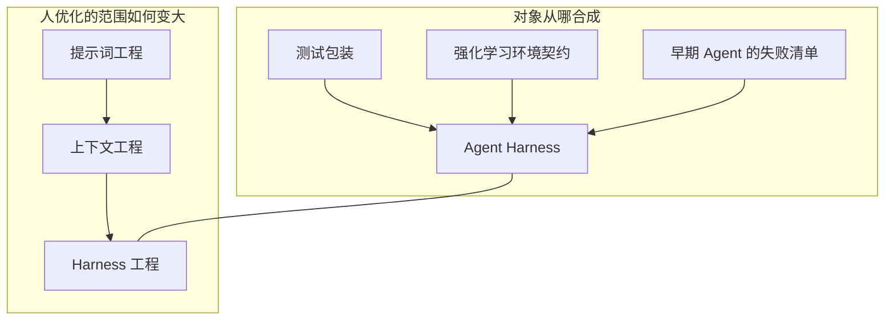
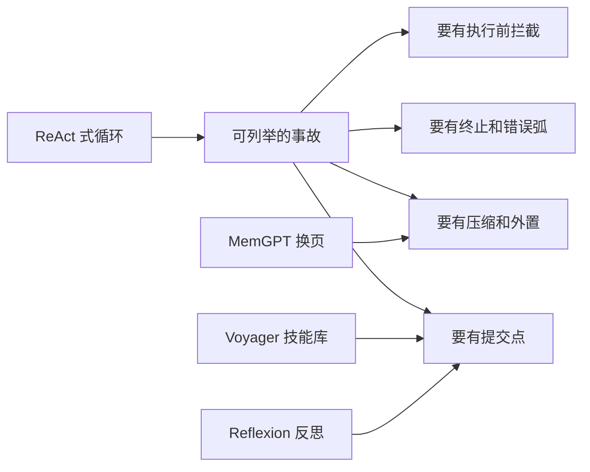
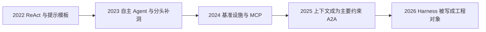
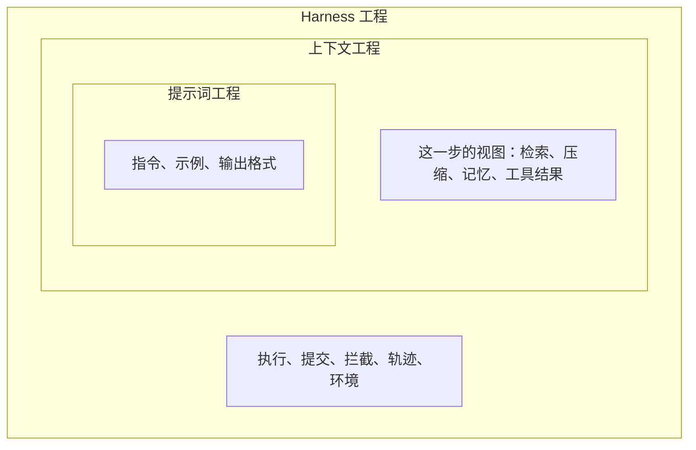
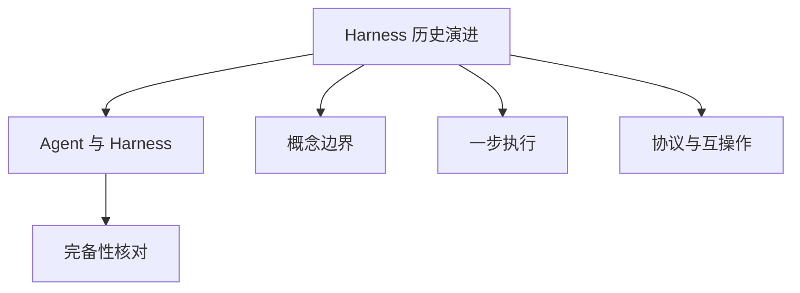

# Harness 历史演进

> **一句话总结**：今天的 Agent Harness 由三条更老的工程传统合成：测试包装给出治理外壳，强化学习环境给出行动契约，早期 Agent 给出必须补上的失败类型。提示词、上下文、Harness 则是另一条演进路径：人要设计的范围逐代变大，后一代把前一代包含进来。

本文遵循本仓库的设计原则：**先讲清「为什么」，再讲「怎么做」**，并标明关联、边界与可核对的证据。六维成熟度本身的定义见 [Agent 与 Harness](Agent与Harness基本原理.md)。

- 适用前提：三条传统的合成和第 4 节的年代划分，依据 Meng 等预印本（2026-04-28 挂出的 v3，页面标明尚未同行评审）第 4 节 [1]。作者仓库另有更新的 PDF，年代和系统名单以你打开的版本为准 [2]。「后一代包含前一代、而不是把前一代作废」这一读法，依据 Li 等的项目页 [3]。模型与 Harness 继续一起变化的判断，依据 LangChain 2026-03-10 的解剖文章 [4] 和 OpenAI 2026-02-11 的工程记录 [5]。**把某一年的标签当成所有团队同时切换手艺的日历，结论会失效。**

---

## 1. 它为什么存在

### 1.1 现在的设计张力能追溯到不完整的旧答案

隔离和能力、可重复和灵活、自动化和人工监督，这几对张力今天仍出现在沙箱、工具格式和批准策略里。它们不是 2024 年才出现的新争论。每条更老的传统都交出了一块可用的答案，也停在自己的假设上 [1]。

只记住「Harness 是模型外面的运行时」，还不能判断一个方案是在补哪一块旧缺口。给命令加超时，补的是早期 Agent 缺少终止条件的那类事故。给每个任务一个可销毁的工作区，补的是强化学习环境里「能够回到已知起点」的那类契约。把测试结果收成结构化记录，补的是测试包装里「结果由外层抓住」的那类习惯。三件事可以同时做，它们回答的是不同传统留下的问题。

### 1.2 两条路径要一起看

本篇把历史收成两条路径，它们都是演进，单位不同。

| 路径 | 在演进的是什么 | 本篇的段落 |
| --- | --- | --- |
| 三条技术传统 | Harness 这个对象从哪些已有工程里合成出来 | 第 2–3 节 |
| 三代工程 | 人实际动手优化的范围如何变大 | 第 4 节 |

Meng 等把第一条写成 *Three Lineages, One Synthesis*：软件测试 Harness、强化学习环境、早期 LLM 框架 [1]。Li 等把第二条写成关注面的扩大：提示词工程塑造一次模型调用，上下文工程管理多步过程中的信息，Harness 工程把二者放进一个会行动的闭环 [3]。Meng 等也为第二条标了年代：提示词工程约 2022–2024，上下文工程约 2025，Harness 工程约 2026，并说明每一代都是把工程范围扩大，而不是宣布前一代结束 [1]。



上图左边是「这个运行时继承了什么」。右边是「工程师当时主要拧哪颗螺丝」。右边的箭头表示范围变大，不表示左边的传统到某年停止起作用。

---

## 2. 三条传统各自交出什么

### 2.1 测试包装：治理外壳

软件测试里的 harness，以 JUnit 为代表，做的是一件边界清楚的事：准备输入，在受控环境里运行被测单元，抓住输出，对照期望 [6]。CI 把准备、拆掉、钩子和结构化日志变成日常。可重复性在这里是包装层的性质：同一段程序要靠外层固定环境，而不是靠程序自己保证每次相同 [1]。

Agent Harness 留下的是这组习惯：执行需要生命周期；结果要被外层收下来；隔离环境是为了让失败可复查。测试包装当初服务的是一次有界、大体确定的程序运行。它没有多回合目标，也没有会自己决定下一步的执行者 [1]。所以它给出「要有一层治理外壳」，没有给出 Agent 运行时的结构。

### 2.2 强化学习环境：行动契约

OpenAI Gym 把智能体和环境拆开。`reset()` 把环境送回起点，`step(action)` 返回下一则观察、一个奖励、是否结束，以及调试信息 [7]。决定做什么，和做了之后世界如何变化，由这套契约隔开。后来的 Gymnasium 继续维护这套接口 [8]。

LLM Agent 继承了契约的形状：工具调用是行动，工具结果是观察，任务是否完成要有显式信号。直接搬用会在四处接不上，综述把这四处写清楚了 [1]：

| Gym 的假设 | 语言模型 Agent 上发生的事 |
| --- | --- |
| 动作来自有限集合 | 模型输出要再解析成工具名和参数 |
| 一个标量奖励评价全程 | 成功常常是「测试通过」「工单关闭」这类组合条件 |
| `reset()` 能精确回到原状态 | 已发出的邮件、已写入的外部系统往往只能补偿 |
| 一步行动有一处效果 | 一次模型输出可以触发多个彼此独立的副作用 |

综述把 BrowserGym 当作这条契约延伸到真实网页的例子：观察、行动和目标状态被固定下来，不同 Agent 才能替换 [1]。网页上的复位仍然比 Gym 的 `reset()` 贵，也更容易因为页面改版而漂移。

### 2.3 早期 Agent：失败清单

ReAct 把推理和行动写成一个循环：模型交替产生思考和行动，行动的观察再送回模型 [9]。它可以落成很短的程序：一个循环、一段提示、一张小工具表。这证明了多步工具使用这条路走得通。它还没有终止预算、压缩、提交点和执行前拦截。综述因此把它当作循环模式的种子，并在形式化讨论里说明：错误输入若没有转移，终止就不可达 [1]。

AutoGPT、BabyAGI 加上持久目标和联网之后，事故变得可以逐条列举 [1][10][11]：

| 当时能看见的事故 | 后来收进的维度 | 依据 |
| --- | --- | --- |
| 没有终止逻辑，执行停不下来 | 执行循环 | 综述对早期自主 Agent 的回溯 [1] |
| 历史只追加，上下文胀满 | 上下文管理 | 同上 |
| 任务中断后进度丢失 | 状态存储 | 同上 |
| 能改文件、发消息，却没有拦截 | 生命周期钩子 | 同上 |

同一时期也有人分头补洞，而不是先写统一运行时。

- Toolformer 让模型在训练中学会调用计算器、搜索和翻译 [12]。Gorilla 把工具选择收成检索 API 文档，用来降低参数幻觉 [13]。ToolLLM 把工具规划收成搜索，要求执行循环能支持多步 API 决策 [14]。综述用这三篇标出工具这一维的推进：从「模型会用工具」，到「靠检索选工具」，再到「循环要能搜索着规划」[1]。
- Voyager 把可运行的技能放进跨回合增长的库，保存的是可复用能力，不是整段原始日志 [15]。
- MemGPT 把上下文窗口比作内存，把外部存储比作磁盘，由运行时决定换入哪一页 [16]。
- Reflexion 把失败轨迹收成口头反思，放进情节缓冲，下一轮读的是学到的判断 [17]。
- Generative Agents 把原始观察和定期抽象分开，检索同时看新近性、重要性和相关性 [18]。

这些系统各自证明一种缺口。协议还嵌在应用代码里，换一层通信或记忆就要改 Agent 本身 [1]。



---

## 3. 2024 年之后：缺口被当成基础设施

到 2024 年，公开系统同时出现几件以前分散的事，综述称之为 harness turn [1]。

**基准本身变成 Harness 工程。** SWE-bench 要在固定提交上安装依赖、跑测试、比较输出 [19]。WebArena 要自托管整站，才能在不依赖外部服务是否改版的前提下做长程网页任务 [20]。GAIA 把人和模型的差距写成环境与工具条件的差距：人可以自由浏览、核对和改道，固定接口下的 Agent 做不到同样的接地 [21]。分数若不可重复，评的是设施，不是模型。

**工具和跨 Agent 通信被抽出协议。** Anthropic 在 2024-11-25 发布 Model Context Protocol，用统一方式连接模型和外部工具、数据源 [22]。Google 在 2025 年发布 Agent2Agent 协议，用身份、能力名片和任务对象描述 Agent 之间的协作，规范仓库在 A2A 项目中维护 [23]。综述把这两件事读成：工具目录和 Agent 间通信不能每个运行时各写一套 [1]。协议固定的是边界上的契约。沙箱、批准和轨迹模式仍要由具体 Harness 实现，这一点在 [Agent 与 Harness](Agent与Harness基本原理.md) 的成熟度表里仍然成立。

**运行时被单独命名。** 综述把 AIOS 列为用操作系统词汇讨论调度、隔离和资源的学术形式化之一 [1]。工业侧，OpenAI 在 2026-02 的记录里写明：早期进度慢，是因为环境规格不足，人要补的是 Agent 能读到、并且机械上拒绝违反的约束 [5]。LangChain 在 2026-03 把同一层命名为 Harness，并报告只改这一层就能移动终端基准的名次 [4]。



这张时间图只标公开文献里容易定位的节点，不是各公司内部开始做运行时的年份。许多团队更早已经有循环和工具，只是还没有把整层叫做 Harness。

---

## 4. 三代工程：关注面变大的路径

### 4.1 每一代在问什么

Meng 等把 2022–2026 的工程焦点收成三代，并强调每一代都扩大了要设计的范围 [1]。Li 等采用同一组名字，并写明这是范围的扩大，不是三段已经结束的历史 [3]。

| 代 | 综述给出的大致时间 [1] | 当时的主问题 | 主要杠杆 | 范围 |
| --- | --- | --- | --- | --- |
| 提示词工程 | 2022–2024 | 这一次调用给模型什么文字 | 指令、少样本、输出格式、推理模板 | 一次或数次模型调用 |
| 上下文工程 | 2025 | 多步过程中模型该看见什么 | 检索、排序、压缩、记忆注入、工具结果裁剪 | 跨步骤的信息状态 |
| Harness 工程 | 2026 | 整个闭环如何让行动可靠 | 环境、工具契约、状态、生命周期、观测、验证、治理 | 包住前两者的执行系统 |

提示词工程的代表方法包括思维链：在提示中要求模型写出中间步骤，从而改变一次调用的推理轨迹 [24]。它优化的是输入文本。任务一旦跨过许多次工具调用，绑定的约束变成「这一步窗口里有什么」。这就是上下文工程的问题：选择、排序、摘要，以及哪些工具结果不该全文回注 [1][3]。

上下文仍然只决定模型看见什么。看见之后的输出要变成文件修改、命令、付款或拒绝，还要在失败后知道做到哪一步。这些是 Harness 工程的问题。Li 等的表述是：更宽的范围把更窄的范围包含在内 [3]。提示词是上下文的一层，上下文是 Harness 的一部分。



读这张图从内到外。改一句系统提示，只动最内层。把超长日志写成文件、窗口里只留路径，动的是中间层。在命令执行前强制批准，并在轨迹里写下策略版本，动的是外层。外层改动可以让内层更好用，例如批准拒绝的文本会回到下一轮上下文；它没有取消内层。

### 4.2 模型和 Harness 一起变

范围变大之后，成绩更明显地属于「模型 + 当时的 Harness」。LangChain 写道：有用的原语先被放进 Harness，再进入下一代模型的后训练；模型会在它训练时所见的文件系统、补丁格式和子代理习惯上变好，换一种等价工具格式就可能变差 [4]。Meng 等汇总的公开报告里，也有「模型不变、只改编辑工具格式或 Harness」带来的大幅分数移动；那些数字的实验设置彼此不同，不能排成一张榜 [1]。细节和引用方式见 [Agent 与 Harness](Agent与Harness基本原理.md) 第 1.2 节。

OpenAI 的工程记录提供了实践一侧的对应物：进度慢的时候，修法不是把提示写得更用力，而是补上环境里缺失的、既能读到又能执行的约束 [5]。这是第三代的典型动作。它仍然使用提示和上下文，只是把反复失效的判断从「再提醒一次」推进到「运行时拒绝违反」。

### 4.3 模型变强以后路径还在

LangChain 预计，规划、自检和长程一致性里，有一部分会被吸进模型，写在提示里的提醒会减少 [4]。环境里有哪些工具、副作用能否回滚、谁必须批准、完成信号从哪来，仍然留在模型外部。所以第三代不会把第一代和第二代清零，也不会在模型足够强之后整段消失。提示词继续决定任务怎么被说出来；上下文继续决定这一步看见哪一页；Harness 继续决定行动是否发生、发生后留在哪。

---

## 5. 边界与代价

### 5.1 适用

用这两条路径，适合判断一份方案实际动了哪一层：

- 一个「最佳实践」若只在某一种测试夹具、某一种 Gym 式环境或某一个 2023 年的自主 Agent 里成立，要写明它继承的是哪条传统的假设。
- 一个改进若只改提示，就不要把它记成 Harness 成熟度的提升。成熟度表见 [Agent 与 Harness](Agent与Harness基本原理.md)。
- 读 2024 年以前的 Agent 论文时，先看它补的是终止、压缩、技能库还是工具检索，再看它有没有把这些收成同一层运行时。

### 5.2 不适用

- **年代不是开关。** Meng 等的 2022–2024 / 2025 / 2026 是工程焦点的大致标签 [1]。Li 等明确反对把它们读成前后替代的历史阶段 [3]。2023 年已经有记忆和工具运行时，2026 年的提示词也仍然有效。
- **三条传统少任何一条，对象都会退回。** 只留测试包装，它仍是跑一遍程序的夹具。只留 Gym 契约，它仍假设短周期和可复位。只留早期那个循环，它仍会在没有预算和提交点时跑飞 [1]。
- **协议发布不等于 Harness 已经标准化。** MCP 和 A2A 抽走的是工具边界和 Agent 间任务 [22][23]。检查点格式、批准事件和轨迹模式，在这两份协议里并没有被一起规定。
- **失败清单里的例子会过时。** AutoGPT 与 BabyAGI 的具体实现已经多次改写 [10][11]。本篇用它们说明 2023 年公开系统暴露过哪类缺口，不用它们的当前版本代表那些缺口今天是否还在。

### 5.3 代价

| 做法 | 它便宜在哪 | 推迟到下一层才付的账 |
| --- | --- | --- |
| 只改提示词 | 立刻能试，不碰执行环境 | 终止、权限和提交点仍会在长任务里失败 |
| 只做上下文压缩 | 窗口还能继续 | 摘要可能吃掉目标和批准记录，行动仍未被拦截 |
| 一次做完六维 | 事故有地方归类 | 批准、轨迹和隔离都有延迟、费用和误拒绝 |
| 把模型升级当成路径的终点 | 少维护一批提醒 | 工具格式、沙箱和完成信号仍要随版本重测 [4][5] |

把每一代都做厚，还有一种特殊代价：模型和某一种 Harness 绑得越紧，迁移到另一种工具格式或另一种沙箱时越要重新验证 [4]。这是演进路径的耦合，不是某一代写错了。

---

## 6. 可验证：一次改动落在哪一层

下面的函数是阅读辅助。它按关键词把一句改动说明分到三代工程，并提示它更接近三条传统里的哪一块。关键词冲突时列出全部命中。它不运行 Agent，也不能代替阅读那次改动的代码。

```python
GENERATIONS = (
    ("harness", ("批准", "钩子", "沙箱", "停止", "预算", "检查点", "幂等", "轨迹", "策略版本")),
    ("context", ("压缩", "摘要", "检索", "窗口", "卸载", "记忆", "技能目录")),
    ("prompt", ("提示", "示例", "系统指令", "输出格式", "思维链")),
)

LINEAGES = (
    ("测试包装", ("隔离", "可重复", "断言", "日志", "钩子", "轨迹")),
    ("环境契约", ("reset", "复位", "观察", "行动", "工作区", "沙箱")),
    ("失败清单", ("停止", "预算", "压缩", "检查点", "批准", "跑飞")),
)


def locate(change: str) -> dict[str, list[str]]:
    generations = [name for name, keys in GENERATIONS if any(k.lower() in change.lower() for k in keys)]
    lineages = [name for name, keys in LINEAGES if any(k.lower() in change.lower() for k in keys)]
    return {
        "generations": generations or ["未命中：换一种说法再试"],
        "lineages": lineages or ["未命中：可能只是产品功能，还没写清补的是哪条传统"],
    }


samples = [
    "在系统提示里增加两则输出格式示例",
    "把超长测试日志卸载到文件，窗口只保留失败行和路径",
    "高权限命令在执行前必须经过批准钩子，并写下策略版本",
    "每个任务使用可销毁的工作区，失败后可以复位到任务开始的提交",
]
for text in samples:
    print(text, "->", locate(text))
```

命中「harness」时，再打开 [Agent 与 Harness](Agent与Harness基本原理.md) 的成熟度表，写下这句改动让 \(E\)、\(T\)、\(C\)、\(S\)、\(L\)、\(V\) 里的哪一维从「调用方补齐」变成「已具备」。只命中「prompt」或「context」时，那一维的档位保持不动。

用手核对时可以不跑脚本，直接答三句：

1. 这句改动若删掉，模型仍能发出同一种工具调用吗？若能，它多半在外层。
2. 它改变的是模型看见的文字，还是行动是否被执行？
3. 它依赖的假设来自测试夹具、可复位环境，还是 2023 年那类跑飞事故？

---

## 7. 关联：它在知识网络中的位置



- **与 Agent 与 Harness**：三条传统解释六维为什么是这六个；三代工程解释为什么提示词和上下文已经在 Harness 里面，却仍然要单独设计。定义和打分在 [Agent与Harness基本原理](Agent与Harness基本原理.md)。
- **与概念边界**：框架、平台、评估设施和 Harness 的分界，是历史合成完成之后的用词问题。索引里仍单独列出「概念边界」。
- **与一步执行**：ReAct 的循环是执行循环的种子。错误弧、提交点和钩子是后来补上的阶段，主题在仓库 `README.md` 的「运行时」。
- **与协议**：MCP 与 A2A 是工具传统和多 Agent 通信被抽出契约的节点 [22][23]。状态、钩子和轨迹还没有同等的公共契约，主题在索引的「协议与互操作」。
- **与完备性核对**：一个 2023 年的循环加工具表，在今天的成熟度表上通常是 \(E\)、\(T\) 部分具备，\(S\)、\(L\)、\(V\) 仍要调用方补齐 [1]。

---

## 8. 延伸阅读

- 本仓库：[Agent 与 Harness](Agent与Harness基本原理.md)；索引在 [`README.md`](../README.md) 的「基础概念」。
- 三条传统、harness turn 和三代年代：Meng 等预印本第 4 节 [1]，作者仓库的 PDF [2]。
- 三代作为范围扩大而不是前后替代：Li 等项目页中 “Prompt, Context, and Harness Engineering” 一节 [3]。
- 模型与 Harness 的共同训练，以及原语如何留在模型外部：LangChain 的解剖文章 [4]。
- 环境规格成为人的主要工作：OpenAI 的 Harness engineering 记录 [5]。

---

## 参考文献

1. Meng, Q., Wang, Y., Chen, L., Li, Y., Wu, W., Jiang, W., Wang, Q., Lu, C., Gao, Y., Wu, Y., and Hu, Y. *Agent Harness for Large Language Model Agents: A Survey*. Preprints.org, manuscript 202604.0428, v3, posted 2026-04-28. 页面标明尚未同行评审。本篇的三条传统、harness turn、三代年代和早期事故归类来自第 4 节。链接：<https://www.preprints.org/manuscript/202604.0428>
2. Awesome-Agent-Harness. 综述作者维护的仓库，含论文 PDF（仓库中可见更新的 v4 文件名）。系统名单和图表以你打开的 PDF 为准。链接：<https://github.com/Gloriaameng/Awesome-Agent-Harness>
3. Li, J., Xiao, X., Zhang, Y., et al. *Agent Harness Engineering: A Survey*. 项目页将提示词、上下文、Harness 写成逐级扩大的设计范围，更宽的范围包含更窄的范围。作者名单以项目页为准。链接：<https://picrew.github.io/LLM-Harness/> ；PDF：<https://picrew.github.io/LLM-Harness/main.pdf>
4. Trivedy, V. *The Anatomy of an Agent Harness*. LangChain Blog, 2026-03-10. 模型与 Harness 的共同演化，以及模型变强之后仍然留在外部的环境、状态和验证。链接：<https://www.langchain.com/blog/the-anatomy-of-an-agent-harness>
5. Lopopolo, R. *Harness engineering: leveraging Codex in an agent-first world*. OpenAI, 2026-02-11. 进度受限于环境是否被写成可读且可执行的约束。链接：<https://openai.com/index/harness-engineering/>
6. JUnit 5 team. *JUnit 5 User Guide*. 当前稳定文档中的测试夹具：准备输入、运行被测代码、断言输出。链接：<https://junit.org/junit5/docs/current/user-guide/>
7. Brockman, G., Cheung, V., Pettersson, L., Schneider, J., Schulman, J., Tang, J., and Zaremba, W. *OpenAI Gym*. arXiv:1606.01540, 2016. `reset` 与 `step` 的智能体—环境接口。链接：<https://arxiv.org/abs/1606.01540>
8. Farama Foundation. *Gymnasium documentation*. Gym 接口的后续维护项目。链接：<https://gymnasium.farama.org/>
9. Yao, S., Zhao, J., Yu, D., Du, N., Shafran, I., Narasimhan, K., and Cao, Y. *ReAct: Synergizing Reasoning and Acting in Language Models*. arXiv:2210.03629, 2022. 推理与行动交替的循环。链接：<https://arxiv.org/abs/2210.03629>
10. Significant Gravitas. *AutoGPT*. 2023 年前后带持久目标的自主 Agent 实现，仓库此后持续改写。链接：<https://github.com/Significant-Gravitas/AutoGPT>
11. Nakajima, Y. *babyagi*. 任务列表驱动的早期自主 Agent。链接：<https://github.com/yoheinakajima/babyagi>
12. Schick, T., et al. *Toolformer: Language Models Can Teach Themselves to Use Tools*. arXiv:2302.04761, 2023. 链接：<https://arxiv.org/abs/2302.04761>
13. Patil, S. G., Zhang, T., Wang, X., and Gonzalez, J. E. *Gorilla: Large Language Model Connected with Massive APIs*. arXiv:2305.15334, 2023. 链接：<https://arxiv.org/abs/2305.15334>
14. Qin, Y., et al. *ToolLLM: Facilitating Large Language Models to Master 16000+ Real-world APIs*. arXiv:2307.16789, 2023. 链接：<https://arxiv.org/abs/2307.16789>
15. Wang, G., et al. *Voyager: An Open-Ended Embodied Agent with Large Language Models*. arXiv:2305.16291, 2023. 链接：<https://arxiv.org/abs/2305.16291>
16. Packer, C., et al. *MemGPT: Towards LLMs as Operating Systems*. arXiv:2310.08560, 2023. 链接：<https://arxiv.org/abs/2310.08560>
17. Shinn, N., et al. *Reflexion: Language Agents with Verbal Reinforcement Learning*. arXiv:2303.11366, 2023. 链接：<https://arxiv.org/abs/2303.11366>
18. Park, J. S., O'Brien, J. C., Cai, C. J., Morris, M. R., Liang, P., and Bernstein, M. S. *Generative Agents: Interactive Simulacra of Human Behavior*. arXiv:2304.03442, 2023. 链接：<https://arxiv.org/abs/2304.03442>
19. Jimenez, C. E., et al. *SWE-bench: Can Language Models Resolve Real-World GitHub Issues?* arXiv:2310.06770, 2023. 链接：<https://arxiv.org/abs/2310.06770>
20. Zhou, S., et al. *WebArena: A Realistic Web Environment for Building Autonomous Agents*. arXiv:2307.13854, 2023. 链接：<https://arxiv.org/abs/2307.13854>
21. Mialon, G., et al. *GAIA: A Benchmark for General AI Assistants*. arXiv:2311.12983, 2023. 链接：<https://arxiv.org/abs/2311.12983>
22. Anthropic. *Introducing the Model Context Protocol*. 2024-11-25. 模型与外部工具、数据源的开放连接方式。链接：<https://www.anthropic.com/news/model-context-protocol>
23. A2A Project. *Agent2Agent (A2A) Protocol*. 跨 Agent 的身份、能力与任务对象。规范与实现以该仓库为准。链接：<https://github.com/a2aproject/A2A>
24. Wei, J., et al. *Chain-of-Thought Prompting Elicits Reasoning in Large Language Models*. arXiv:2201.11903, 2022. 链接：<https://arxiv.org/abs/2201.11903>

### 图片来源与许可声明

本文的图都是 **Mermaid 自绘**（`flowchart`），由 GitHub 在渲染 Markdown 时画出。没有从论文 PDF、博客或产品文档下载插图。Meng 等的演化时间线图、LangChain 与 OpenAI 页面上的配图版权归各自作者或出版方，本仓库不转载；需要看原图时打开上面的链接。

| 图 | 位置 | 类型 | 说明 |
| --- | --- | --- | --- |
| 两条演进路径 | 第 1.2 节 | Mermaid flowchart | 自绘。左边的合成依据文献 [1]，右边的范围扩大依据文献 [1][3] |
| 早期事故与补洞 | 第 2.3 节 | Mermaid flowchart | 自绘。事故归类依据文献 [1]，补洞例子依据文献 [15][16][17] |
| 公开节点的时间顺序 | 第 3 节 | Mermaid flowchart | 自绘。只标本篇引用里能定位的公开节点，不是原文献的时间线图 |
| 三代范围从内到外 | 第 4.1 节 | Mermaid flowchart | 自绘。包含关系依据文献 [3] |
| 在知识网络中的位置 | 第 7 节 | Mermaid flowchart | 自绘，对应本仓库 `README.md` 的索引 |

自绘图只表达本篇的结构，不表示原作者认可这张图的画法。
