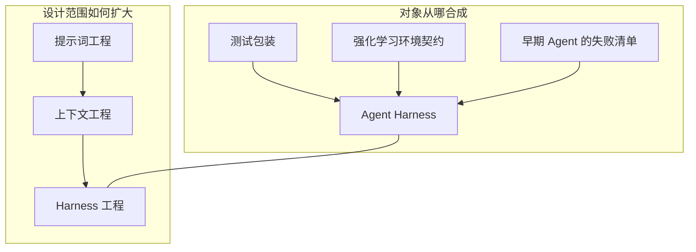
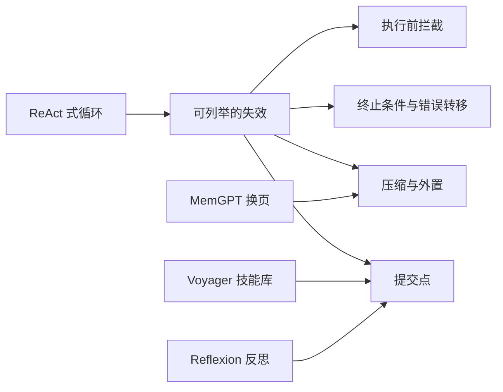
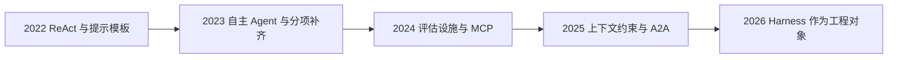
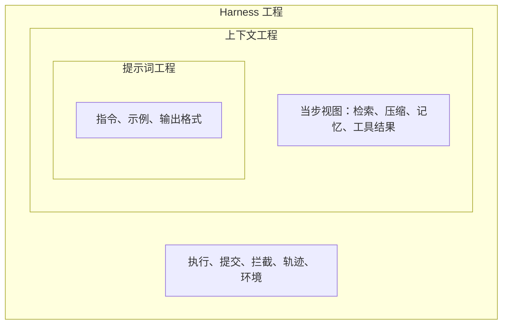
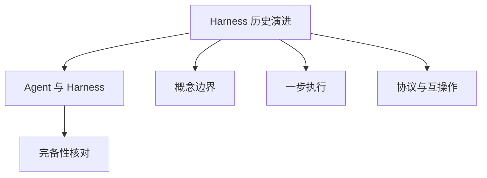

# Harness 历史演进

## 摘要

当前所称的 Agent Harness，由三条既有工程传统合成：软件测试中的 Harness 提供治理外壳，强化学习环境提供行动契约，早期语言模型 Agent 暴露出必须补齐的失效类型。提示词工程、上下文工程和 Harness 工程构成另一条演进路径。该路径描述的是设计范围逐代扩大：后一范围包含前一范围，前一范围中的方法继续有效。六维成熟度的定义见 [Agent 与 Harness](Agent与Harness基本原理.md)。

## 范围与材料

三条传统的合成，以及第 4 节的年代划分，依据 Meng 等预印本第 4 节。该文于 2026-04-28 以 v3 发布，页面标明尚未同行评审 [1]。作者仓库另有后续 PDF，年代和系统名单以所读版本为准 [2]。“后一范围包含前一范围”的读法依据 Li 等的项目页 [3]。模型与 Harness 共同变化的判断依据 LangChain 2026-03-10 的文章 [4] 和 OpenAI 2026-02-11 的工程记录 [5]。年代标签表示公开文献中的工程焦点，不表示各团队在同一时间更换方法。

---

## 1. 它为什么存在

### 1.1 当前设计约束的来源

隔离与能力、可重复与灵活、自动化与人工监督，仍然出现在沙箱、工具格式和批准策略中。这些约束在 2024 年之前已有对应的工程答案，每条答案也带有自己的前提 [1]。

因此，仅有“Harness 是模型之外的运行时”这一定义，还不能判断某项改动继承了哪条前提。为命令增加超时，对应早期 Agent 中缺少终止条件的失效。为每个任务提供可销毁的工作区，对应强化学习环境中回到已知起点的契约。将测试结果写入结构化记录，对应测试 Harness 中由外层捕获结果的做法。三项改动可以并存，它们回答的问题不同。

### 1.2 对象合成与设计范围

本文把历史分为两条路径。二者都是演进，观察单位不同。

| 路径 | 观察对象 | 本文位置 |
| --- | --- | --- |
| 三条技术传统 | Harness 由哪些既有工程合成 | 第 2–3 节 |
| 三代工程 | 设计与优化的范围如何扩大 | 第 4 节 |

Meng 等将第一条路径称为 *Three Lineages, One Synthesis*，三条传统分别是软件测试 Harness、强化学习环境和早期 LLM 框架 [1]。Li 等将第二条路径写成设计范围的扩大：提示词工程规定一次模型调用，上下文工程管理多步执行中的信息，Harness 工程把二者放入可产生行动的闭环 [3]。Meng 等也为第二条路径标注了大致时间：提示词工程约 2022–2024，上下文工程约 2025，Harness 工程约 2026，并说明每一阶段都是范围扩大，前一阶段的方法并未终止 [1]。



左图表示运行时继承的结构。右图表示公开文献中设计焦点的变化。右图的箭头表示范围扩大；左图中的传统在后续年份继续有效。

---

## 2. 三条传统的贡献与前提

### 2.1 测试 Harness：治理外壳

以 JUnit 为代表的测试 Harness 准备输入，在受控环境中运行被测单元，捕获输出，并与期望比较 [6]。持续集成将准备、清理、钩子和结构化日志变为常规步骤。在该传统中，可重复性属于包装层：同一程序依赖外层固定环境 [1]。

Agent Harness 保留了其中三项要求：执行具有生命周期，结果由外层收集，隔离环境用于复查失败。测试 Harness 的原始对象是一次有界、大体确定的程序运行。它不包含多回合目标，也不包含自行决定下一步的执行者 [1]。它对 Agent 运行时的贡献是治理外壳这一模式，未给出后者的内部结构。

### 2.2 强化学习环境：行动契约

OpenAI Gym 将智能体与环境分离。`reset()` 将环境恢复到起点，`step(action)` 返回下一观察、奖励、是否结束以及调试信息 [7]。行动的选择与行动之后的状态转移由该接口分开。Gymnasium 继续维护这一接口 [8]。

语言模型 Agent 沿用了接口的形状：工具调用对应行动，工具结果对应观察，任务完成需要显式信号。综述列出四项不能直接沿用的前提 [1]：

| Gym 的前提 | 语言模型 Agent 中的对应情况 |
| --- | --- |
| 动作取自有限集合 | 模型输出需要解析为工具名和参数 |
| 全程由一个标量奖励评价 | 成功条件常为测试通过、工单关闭等组合谓词 |
| `reset()` 可以精确恢复原状态 | 已发出的外部操作通常只能补偿 |
| 一步行动对应一处效果 | 一次模型输出可以触发多处相互独立的副作用 |

综述将 BrowserGym 作为该契约延伸到真实网页的例子：观察、行动和目标状态被固定后，不同 Agent 才能替换 [1]。网页环境的复位成本高于 Gym 的 `reset()`，也更容易因页面变更而漂移。

### 2.3 早期 Agent：失效类型

ReAct 将推理与行动写成循环：模型交替生成推理和行动，行动的观察再送回模型 [9]。其实现可以很短，由循环、提示和小型工具表组成。这表明多步工具使用是可行的。该循环尚未包含终止预算、压缩、提交点和执行前拦截。综述在形式化讨论中指出：若错误输入没有对应转移，则终止状态不可达 [1]。

AutoGPT 与 BabyAGI 在持久目标和网络访问之下，使若干失效变得可列举 [1][10][11]：

| 观察到的失效 | 后来对应的维度 | 依据 |
| --- | --- | --- |
| 缺少终止逻辑，执行无法停止 | 执行循环 | 综述对早期自主 Agent 的回溯 [1] |
| 历史只追加，上下文超出可用窗口 | 上下文管理 | 同上 |
| 任务中断后进度丢失 | 状态存储 | 同上 |
| 可以修改文件或发送消息，但缺少拦截 | 生命周期钩子 | 同上 |

同一时期的其他系统分别处理其中某一缺口，尚未形成统一运行时。

- Toolformer 在训练中使模型调用计算器、搜索和翻译 [12]。Gorilla 将工具选择实现为对 API 文档的检索，以降低参数幻觉 [13]。ToolLLM 将工具规划实现为搜索，因此执行循环需要支持多步 API 决策 [14]。综述用这三项工作描述工具维度的推进：由模型具备工具使用能力，到借助检索选择工具，再到循环支持搜索式规划 [1]。
- Voyager 将可执行技能放入跨回合增长的库中。库中保存的是可复用能力；完整的原始日志留在该库之外 [15]。
- MemGPT 将上下文窗口类比为内存，将外部存储类比为磁盘，由运行时决定换入哪一页 [16]。
- Reflexion 将失败轨迹转换为文字形式的反思，放入情节缓冲；下一轮读取的是该反思 [17]。
- Generative Agents 将原始观察与定期抽象分开存储，检索同时使用新近性、重要性和相关性 [18]。

这些系统各自验证了一种缺口。通信和记忆协议仍嵌在应用代码中，替换其中一层需要修改 Agent 本身 [1]。



---

## 3. 2024 年之后的基础设施化

综述将 2024 年之后若干原先分散的工作同时出现的现象称为 harness turn [1]。

**评估设施本身成为 Harness 工程。** SWE-bench 需要在固定提交上安装依赖、运行测试并比较输出 [19]。WebArena 自托管完整网站，以降低对外部服务变更的依赖 [20]。GAIA 将人与模型的差距与环境和工具条件联系起来：人可以浏览、核对并改变路径，受固定接口约束的 Agent 不具备同等的环境操作能力 [21]。若运行不可重复，测量对象包含评估设施。

**工具与跨 Agent 通信形成协议。** Anthropic 于 2024-11-25 发布 Model Context Protocol，用于连接模型与外部工具、数据源 [22]。Google 于 2025 年发布 Agent2Agent 协议，以身份、能力描述和任务对象表示 Agent 之间的协作；规范由 A2A 项目仓库维护 [23]。综述据此认为，工具目录和 Agent 间通信不宜由每个运行时单独定义 [1]。协议规定的是边界契约。沙箱、批准和轨迹模式仍由具体 Harness 实现，对应关系见 [Agent 与 Harness](Agent与Harness基本原理.md) 的成熟度表。

**运行时被作为独立对象讨论。** 综述将 AIOS 列为用操作系统概念讨论调度、隔离和资源的工作之一 [1]。OpenAI 在 2026-02 的记录中写道，早期进度受限于环境规格：需要补充 Agent 可以读取、并且可以由程序拒绝违反的约束 [5]。LangChain 在 2026-03 将这一层称为 Harness，并报告只修改该层即可改变终端基准上的名次 [4]。



该图标注本篇引用中可以定位的公开节点。各组织内部开始实现运行时的时间需要另行考证。许多系统更早已经具备循环和工具，只是尚未将整层命名为 Harness。

---

## 4. 三代工程

### 4.1 设计范围

Meng 等将 2022–2026 年的工程焦点分为三代，并强调每一代都扩大了设计范围 [1]。Li 等使用同一组名称，并说明这是范围扩大，前一代方法并不因此结束 [3]。

| 代 | 综述给出的大致时间 [1] | 主要问题 | 主要手段 | 范围 |
| --- | --- | --- | --- | --- |
| 提示词工程 | 2022–2024 | 单次调用向模型提供什么文本 | 指令、少样本、输出格式、推理模板 | 一次或数次模型调用 |
| 上下文工程 | 2025 | 多步执行中模型看到什么信息 | 检索、排序、压缩、记忆注入、工具结果裁剪 | 跨步骤的信息状态 |
| Harness 工程 | 2026 | 闭环如何使行动可靠 | 环境、工具契约、状态、生命周期、观测、验证、治理 | 包含前两者的执行系统 |

思维链是提示词工程的代表方法：提示要求模型写出中间步骤，从而改变一次调用的推理轨迹 [24]。其优化对象是输入文本。当任务包含多次工具调用时，约束变为当步窗口中的信息集合。上下文工程处理该集合的选择、排序和摘要，并决定哪些工具结果不以全文回注 [1][3]。

上下文规定模型看到的信息。模型输出要成为文件修改、命令、外部操作或拒绝，并在失败后保留进度，属于 Harness 工程。Li 等的表述是：较宽的范围包含较窄的范围 [3]。提示词是上下文中的一层，上下文是 Harness 中的一部分。



图由内向外表示范围。修改系统提示只改变最内层。将过长日志写入文件、在窗口中保留路径，改变中间层。在命令执行前实施批准并记录策略版本，改变外层。外层可以向上下文提供新材料，例如拒绝原因进入下一轮输入；外层的存在不取消内层。

### 4.2 模型与 Harness 的共同变化

设计范围扩大后，测量结果更明确地依赖于模型与当时 Harness 的组合。LangChain 描述了如下循环：可用的运行时原语先进入 Harness，再进入下一代模型的后训练；模型在训练中所见的文件系统、补丁格式和子代理习惯上表现更好，更换语义等价的工具格式后性能可能下降 [4]。Meng 等汇总的公开报告中，也有模型不变、只改变编辑工具格式或 Harness 时分数大幅变化的例子。这些实验设置不同，不能合并排名 [1]。数值及引用方式见 [Agent 与 Harness](Agent与Harness基本原理.md) 第 1.2 节。

OpenAI 的记录给出对应的工程现象：进度不足时，有效修改是补齐环境中缺失的、既可读取又可执行的约束 [5]。加长提示不能替代该约束。该修改属于第三代的典型操作。它仍然使用提示和上下文，并把反复失效的约束从文本提醒推进到运行时拒绝。

### 4.3 模型能力提高之后的保留项

LangChain 预计，规划、自检和长程一致性中的一部分将由模型承担，提示中的相应提醒会减少 [4]。可用工具、副作用能否回滚、批准条件以及完成信号的来源，仍然位于模型之外。前两代的对象在第三代中继续存在：提示词规定任务的表述，上下文规定当步可见信息，Harness 规定行动是否执行以及执行后的状态。

---

## 5. 边界与代价

### 5.1 适用条件

两条路径用于判断一项方案实际改变了哪一层：

- 若某项做法只在特定测试夹具、特定 Gym 式环境或某个 2023 年的自主 Agent 中成立，需要写明它继承的前提。
- 只修改提示的改进，不记入 Harness 成熟度的提升。成熟度表见 [Agent 与 Harness](Agent与Harness基本原理.md)。
- 阅读 2024 年以前的 Agent 论文时，先确定它补齐的是终止、压缩、技能库还是工具检索，再确定这些机制是否已经位于同一运行时层。

### 5.2 不适用条件

- Meng 等给出的 2022–2024、2025 和 2026 是工程焦点的近似标签 [1]。Li 等明确不把它们解释为相互替代的历史阶段 [3]。2023 年已存在记忆和工具运行时，2026 年的提示词方法仍然适用。
- 三条传统共同构成当前对象。只保留测试 Harness，对象仍是单次程序夹具；只保留 Gym 契约，对象仍假设短周期和可复位；只保留早期循环，对象在缺少预算和提交点时无法保证终止 [1]。
- MCP 与 A2A 的发布不表示 Harness 已经完全标准化。二者分别规定工具边界和 Agent 间任务 [22][23]。检查点格式、批准事件和轨迹模式不在这两份协议的统一范围内。
- AutoGPT 与 BabyAGI 的实现已经多次改写 [10][11]。本文用它们说明 2023 年公开系统暴露的缺口类型，不用其当前版本代表这些缺口今天是否仍然存在。

### 5.3 代价

| 做法 | 较低的即时成本 | 留到外层处理的问题 |
| --- | --- | --- |
| 只修改提示词 | 可以立即试验，不改变执行环境 | 长任务中的终止、权限和提交点仍然缺少机制 |
| 只做上下文压缩 | 窗口可以继续容纳后续步骤 | 摘要可能删除目标和批准记录，行动本身仍未被拦截 |
| 一次实现全部六维 | 失效可以按维度归类 | 批准、轨迹和隔离带来延迟、费用和误拒绝 |
| 将模型升级视为路径终点 | 可以减少一批提示提醒 | 工具格式、沙箱和完成信号仍需随版本重新验证 [4][5] |

模型与某一种 Harness 的结合越紧密，迁移到另一种工具格式或沙箱时需要重新验证的范围越大 [4]。这是演进路径中的耦合。

---

## 6. 可验证的层次标注

下列函数按关键词将一条改动说明标注到三代工程，并提示它与哪条技术传统更接近。多个关键词同时命中时，返回全部命中。函数不执行 Agent，也不能代替阅读改动本身。

```python
GENERATIONS = (
    ("harness", ("批准", "钩子", "沙箱", "停止", "预算", "检查点", "幂等", "轨迹", "策略版本")),
    ("context", ("压缩", "摘要", "检索", "窗口", "卸载", "记忆", "技能目录")),
    ("prompt", ("提示", "示例", "系统指令", "输出格式", "思维链")),
)

LINEAGES = (
    ("测试包装", ("隔离", "可重复", "断言", "日志", "钩子", "轨迹")),
    ("环境契约", ("reset", "复位", "观察", "行动", "工作区", "沙箱")),
    ("失败清单", ("停止", "预算", "压缩", "检查点", "批准", "无法终止")),
)


def locate(change: str) -> dict[str, list[str]]:
    generations = [name for name, keys in GENERATIONS if any(k.lower() in change.lower() for k in keys)]
    lineages = [name for name, keys in LINEAGES if any(k.lower() in change.lower() for k in keys)]
    return {
        "generations": generations or ["未命中"],
        "lineages": lineages or ["未命中"],
    }


samples = [
    "在系统提示里增加两则输出格式示例",
    "把超长测试日志卸载到文件，窗口只保留失败行和路径",
    "高权限命令在执行前必须经过批准钩子，并写下策略版本",
    "每个任务使用可销毁的工作区，失败后可以复位到任务开始的提交",
]
for text in samples:
    print(text, "->", locate(text))
```

若结果包含 `harness`，再按 [Agent 与 Harness](Agent与Harness基本原理.md) 的成熟度表，记录该改动使 \(E\)、\(T\)、\(C\)、\(S\)、\(L\)、\(V\) 中哪一维由“调用方补齐”变为“已具备”。若只包含 `prompt` 或 `context`，各维档位保持不变。

不运行脚本时，可以用三个问题完成同一分类：

1. 删除该改动后，模型是否仍能发出同一种工具调用。若仍能发出，改动多半位于运行时外层。
2. 改动改变的是模型可见的文本，还是行动是否被执行。
3. 改动所依赖的前提来自测试夹具、可复位环境，还是 2023 年缺少终止与提交的失效。

---

## 7. 关联



- **Agent 与 Harness**：三条传统说明六维的来源；三代工程说明提示词和上下文位于 Harness 之内、同时仍需单独设计。定义与评分见 [Agent与Harness基本原理](Agent与Harness基本原理.md)。
- **概念边界**：框架、平台、评估设施与 Harness 的区分，是上述合成完成之后的术语问题。该主题在索引中单独列出。
- **一步执行**：ReAct 的循环是执行循环的早期形式。错误转移、提交点和钩子是随后增加的阶段，主题位于 `README.md` 的「运行时」。
- **协议**：MCP 与 A2A 分别将工具接口和多 Agent 通信提取为契约 [22][23]。状态、钩子和轨迹尚无同等的公共契约，主题为索引中的「协议与互操作」。
- **完备性核对**：2023 年由循环和工具表组成的系统，在当前成熟度表上通常是 \(E\)、\(T\) 部分具备，\(S\)、\(L\)、\(V\) 仍由调用方补齐 [1]。

---

## 8. 延伸阅读

- 本仓库：[Agent 与 Harness](Agent与Harness基本原理.md)；索引见 [`README.md`](../README.md) 的「基础概念」。
- 三条传统、harness turn 和三代年代：Meng 等预印本第 4 节 [1]；作者仓库中的 PDF [2]。
- 三代作为范围扩大：Li 等项目页 “Prompt, Context, and Harness Engineering” 一节 [3]。
- 模型与 Harness 的共同训练：Trivedy, *The Anatomy of an Agent Harness* [4]。
- 环境规格对工程进度的约束：Lopopolo, *Harness engineering* [5]。

---

## 参考文献

1. Meng, Q., Wang, Y., Chen, L., Li, Y., Wu, W., Jiang, W., Wang, Q., Lu, C., Gao, Y., Wu, Y., and Hu, Y. *Agent Harness for Large Language Model Agents: A Survey*. Preprints.org, manuscript 202604.0428, v3, posted 2026-04-28. 页面标明尚未同行评审。本篇的三条传统、harness turn、三代年代和早期失效归类来自第 4 节。链接：<https://www.preprints.org/manuscript/202604.0428>
2. Awesome-Agent-Harness. 综述作者维护的仓库，含论文 PDF（仓库中可见更新的 v4 文件名）。系统名单和图表以所读 PDF 为准。链接：<https://github.com/Gloriaameng/Awesome-Agent-Harness>
3. Li, J., Xiao, X., Zhang, Y., et al. *Agent Harness Engineering: A Survey*. 项目页将提示词、上下文、Harness 写成逐级扩大的设计范围，较宽范围包含较窄范围。作者名单以项目页为准。链接：<https://picrew.github.io/LLM-Harness/> ；PDF：<https://picrew.github.io/LLM-Harness/main.pdf>
4. Trivedy, V. *The Anatomy of an Agent Harness*. LangChain Blog, 2026-03-10. 讨论模型与 Harness 的共同演化，以及模型能力提高后仍留在外部的环境、状态和验证。链接：<https://www.langchain.com/blog/the-anatomy-of-an-agent-harness>
5. Lopopolo, R. *Harness engineering: leveraging Codex in an agent-first world*. OpenAI, 2026-02-11. 记录进度受环境是否被写成可读且可执行约束的影响。链接：<https://openai.com/index/harness-engineering/>
6. JUnit 5 team. *JUnit 5 User Guide*. 当前稳定文档中的测试夹具：准备输入、运行被测代码、断言输出。链接：<https://junit.org/junit5/docs/current/user-guide/>
7. Brockman, G., Cheung, V., Pettersson, L., Schneider, J., Schulman, J., Tang, J., and Zaremba, W. *OpenAI Gym*. arXiv:1606.01540, 2016. `reset` 与 `step` 的智能体—环境接口。链接：<https://arxiv.org/abs/1606.01540>
8. Farama Foundation. *Gymnasium documentation*. Gym 接口的后续维护项目。链接：<https://gymnasium.farama.org/>
9. Yao, S., Zhao, J., Yu, D., Du, N., Shafran, I., Narasimhan, K., and Cao, Y. *ReAct: Synergizing Reasoning and Acting in Language Models*. arXiv:2210.03629, 2022. 推理与行动交替的循环。链接：<https://arxiv.org/abs/2210.03629>
10. Significant Gravitas. *AutoGPT*. 2023 年前后带持久目标的自主 Agent 实现，仓库此后持续改写。链接：<https://github.com/Significant-Gravitas/AutoGPT>
11. Nakajima, Y. *babyagi*. 任务列表驱动的早期自主 Agent。链接：<https://github.com/yoheinakajima/babyagi>
12. Schick, T., et al. *Toolformer: Language Models Can Teach Themselves to Use Tools*. arXiv:2302.04761, 2023. 链接：<https://arxiv.org/abs/2302.04761>
13. Patil, S. G., Zhang, T., Wang, X., and Gonzalez, J. E. *Gorilla: Large Language Model Connected with Massive APIs*. arXiv:2305.15334, 2023. 链接：<https://arxiv.org/abs/2305.15334>
14. Qin, Y., et al. *ToolLLM: Facilitating Large Language Models to Master 16000+ Real-world APIs*. arXiv:2307.16789, 2023. 链接：<https://arxiv.org/abs/2307.16789>
15. Wang, G., et al. *Voyager: An Open-Ended Embodied Agent with Large Language Models*. arXiv:2305.16291, 2023. 链接：<https://arxiv.org/abs/2305.16291>
16. Packer, C., et al. *MemGPT: Towards LLMs as Operating Systems*. arXiv:2310.08560, 2023. 链接：<https://arxiv.org/abs/2310.08560>
17. Shinn, N., et al. *Reflexion: Language Agents with Verbal Reinforcement Learning*. arXiv:2303.11366, 2023. 链接：<https://arxiv.org/abs/2303.11366>
18. Park, J. S., O'Brien, J. C., Cai, C. J., Morris, M. R., Liang, P., and Bernstein, M. S. *Generative Agents: Interactive Simulacra of Human Behavior*. arXiv:2304.03442, 2023. 链接：<https://arxiv.org/abs/2304.03442>
19. Jimenez, C. E., et al. *SWE-bench: Can Language Models Resolve Real-World GitHub Issues?* arXiv:2310.06770, 2023. 链接：<https://arxiv.org/abs/2310.06770>
20. Zhou, S., et al. *WebArena: A Realistic Web Environment for Building Autonomous Agents*. arXiv:2307.13854, 2023. 链接：<https://arxiv.org/abs/2307.13854>
21. Mialon, G., et al. *GAIA: A Benchmark for General AI Assistants*. arXiv:2311.12983, 2023. 链接：<https://arxiv.org/abs/2311.12983>
22. Anthropic. *Introducing the Model Context Protocol*. 2024-11-25. 模型与外部工具、数据源的连接方式。链接：<https://www.anthropic.com/news/model-context-protocol>
23. A2A Project. *Agent2Agent (A2A) Protocol*. 跨 Agent 的身份、能力与任务对象。规范与实现以该仓库为准。链接：<https://github.com/a2aproject/A2A>
24. Wei, J., et al. *Chain-of-Thought Prompting Elicits Reasoning in Large Language Models*. arXiv:2201.11903, 2022. 链接：<https://arxiv.org/abs/2201.11903>

### 图片来源与许可声明

本文图示均为 Mermaid `flowchart`，在 Markdown 渲染时生成，未从论文、博客或产品文档下载原图。Meng 等的演化时间线图以及 LangChain、OpenAI 页面中的配图版权归原作者或出版方；阅读原图请使用上文链接。

| 图 | 位置 | 类型 | 说明 |
| --- | --- | --- | --- |
| 两条演进路径 | 第 1.2 节 | Mermaid flowchart | 自绘。对象合成依据文献 [1]，范围扩大依据文献 [1][3] |
| 早期失效与后续机制 | 第 2.3 节 | Mermaid flowchart | 自绘。失效归类依据文献 [1]，后续机制依据文献 [15][16][17] |
| 公开节点的时间顺序 | 第 3 节 | Mermaid flowchart | 自绘。只标注本篇引用中可定位的公开节点 |
| 三代范围由内向外 | 第 4.1 节 | Mermaid flowchart | 自绘。包含关系依据文献 [3] |
| 在知识网络中的位置 | 第 7 节 | Mermaid flowchart | 自绘，对应本仓库 `README.md` 的索引 |

自绘图表示本篇的结构，不表示原作者认可该画法。
