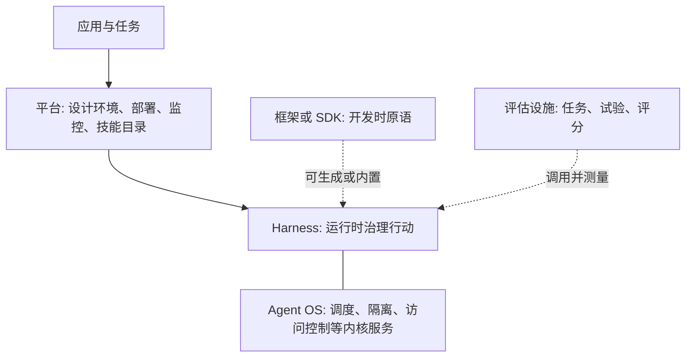
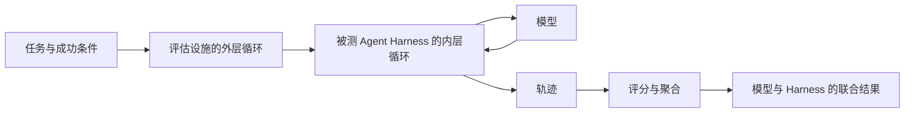
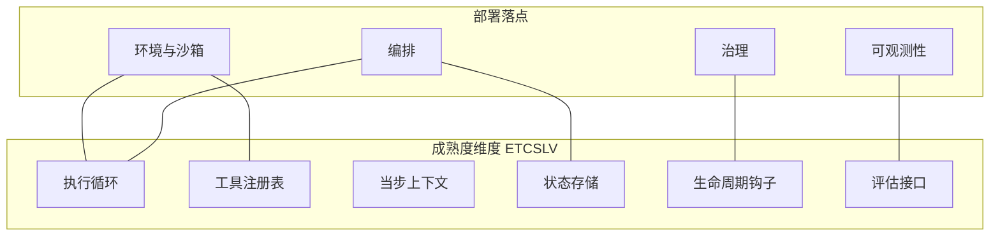
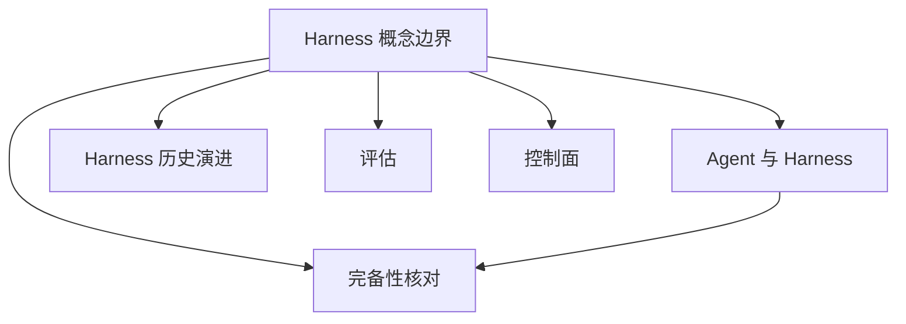

# Harness 概念边界

## 摘要

“Harness”在公开文献和产品文档中同时指开发时的组装原语、运行时的行动治理、多用户平台，以及测试时的测量设施。本文以决策发生的位置为判据，区分框架、Harness、平台、Agent OS 和评估设施。Agent OS 在 Meng 等的划分中是 Harness 的一种严格实现，平台通常把 Harness 作为运行时基底。评估设施至少有两种用法：只批量测量模型的设施，以及在任务外层驱动并给 Agent 打分的设施。\(H=(E,T,C,S,L,V)\) 与 ETCLOVG 使用部分相同字母，所指层次不同。成熟度如何打分见 [Agent 与 Harness](Agent与Harness基本原理.md)。

## 范围与材料

五类对象的主表依据 Meng 等预印本第 3.4 节表 2。该文于 2026-04-28 以 v3 发布，页面标明尚未同行评审；作者仓库另有后续 PDF，系统举例以所读版本为准 [1][2]。七层工程表面依据 Li 等的项目页；该页写明页面内容以 CC BY-SA 4.0 发布，并给出 OpenReview PDF [3]。模型与 Harness 的操作定义依据 LangChain 2026-03-10 的文章 [4]。追踪、评估与 Harness 的分工依据 Arize 的说明 [5]。Agent 评估设施与 scaffold 的公开定义依据 Anthropic 2026-01-09 的工程笔记 [6]，以及 Claude Code 术语表中的 *Agentic harness* 条目；术语表为在线文档，引用前应核对当前页面 [7]。Agent OS 的内核服务依据 Mei 等的 AIOS 论文 [8]。框架内置一套可运行 Harness 的产品实例依据 Microsoft Agent Framework 的当前文档 [9]。另一项成员资格分析见 Macedo 的预印本，arXiv:2606.10106，页面日期为 2026-08-24 [10]。产品名称不构成分类。

---

## 1. 它为什么存在

### 1.1 同一名称覆盖多层

Meng 等指出，该词长期同时碰到框架、环境、scaffold 和平台，每种说法只覆盖对象的一部分 [1]。因此，把一条建议记在“Harness”名下，还不能确定它改变的是组装接口、行动循环、部署平台，还是评分程序。

四类常见错位如下。

| 观察到的说法 | 实际改变的层 | 后果 |
| --- | --- | --- |
| 在 SDK 中增加一个工具类 | 开发时的组装原语 | 运行中的参数校验和批准可以仍然缺失 |
| 将排行榜分数记为模型能力 | 模型、Agent Harness 与评估设施的联合结果 | 更换执行器或评分规则后，分数可以在模型不变时变化 [1][6] |
| 将操作系统式调度称为另一类产品 | 共享资源上的运行时治理 | 调度、隔离和访问控制仍需按 Harness 维度检验 [1][8] |
| 将提示修改记为运行时成熟度提升 | 一次模型调用的输入文本 | 停止条件、提交点和执行前拦截保持原状 |

LangChain 给出的操作边界是：模型之外的代码、配置和执行逻辑属于 Harness [4]。该句划出模型与其余部分。它尚未区分其余部分内部的框架、平台和评估设施。第 2 节处理这一内部区分。

### 1.2 判据

本文对一个具体系统提出三个问题。

1. 该项决策在开发者组装系统时生效，还是在一次任务执行时生效。
2. 该项决策改变的是单个 Agent 的下一步行动，还是多个 Agent、多次运行共享的设计、部署和权限管理。
3. 该项决策在行动进行中约束执行，还是在行动结束后对记录评分。

三个问题分别对应框架与 Harness、Harness 与平台、Harness 与评估设施。Agent OS 由第 1 问的运行时一侧，加上内核服务是否被单独实现来判定。字母体系的对照放在第 3 节，避免把层名当成产品名。

---

## 2. 五类对象

### 2.1 主表

Meng 等用下表分开五个相邻概念 [1]。中文为本文对表 2 的转写，英文职责以预印本原文为准。

| 概念 | 主要职责 [1] | 作用时间 | 是否构成运行时 | 它回答的问题 |
| --- | --- | --- | --- | --- |
| 框架 | 构造原语 | 开发时 | 否 | Agent 如何被组装 |
| Harness | 运行时治理 | 运行时 | 是 | Agent 如何可靠地运行 |
| 平台 | 组织级管理 | 开发时与运行时 | 两者都有 | Agent 如何被规模化管理 |
| Agent OS | 形式化的内核服务 | 运行时 | 是 | 最小治理抽象是什么 |
| 评估 Harness | 测量基础设施 | 测试时 | 部分 | 行为如何被测量 |

综述给出的例子是：框架包括 LangChain、LlamaIndex 和 PydanticAI；平台包括 Manus、Microsoft Copilot Studio 和 AWS Multi-Agent Orchestrator；评估 Harness 以 EleutherAI 的语言模型批量测试设施为例，并判断它实现了六维中的评估接口，未实现执行循环、工具、上下文、状态和钩子；Agent OS 以操作系统理论讨论调度、内存、访问控制和存储隔离 [1]。这些例子用于说明层，不表示被点名的产品在所有版本上都只占据一层。



实线表示运行时从属。虚线表示可以同时存在。Agent OS 画在 Harness 旁边，因为综述把它当作 Harness 的严格实现，而不是与 Harness 互斥的一层 [1]。

### 2.2 框架可以生成 Harness，也可以只提供组件

框架提供开发时用来组装 Agent 的原语 [1]。Arize 将同一区分写成两个问题：框架回答开发者如何组装系统，Harness 回答 Agent 如何安全、持久地执行 [5]。同一代码库可以同时包含二者。分类依据是运行时决策的位置。

Microsoft Agent Framework 的文档把 Harness 定义为把语言模型变成可执行工作的运行时支架：驱动模型和工具调用，管理对话状态与上下文，实施批准，并使多步任务继续推进。其 Harness 由聊天客户端、调用流水线、上下文提供者和中间件组合而成，并默认发出 OpenTelemetry 数据 [9]。在该产品中，框架是组件来源，Harness 是这些组件被接成的可运行循环。只引用框架名称，不能判断批准、压缩和遥测是否已经接入。

Macedo 的预印本给出一个可操作的分离案例：只在角色之间转发消息、而没有对外部环境的行动循环，属于框架的组合能力；使单个 Agent 对仓库或工具采取下一步行动，属于其下的 Harness。该文同时把 SDK 定为原料：提供函数调用和循环原语，但在开发者写完循环之前不构成运行中的 Agent [10]。本文沿用这一分离，并用 Meng 等的六维记录 Harness 一旦存在之后达到哪一档。SDK 与框架都回答组装问题，本文不把 SDK 单列为第七类评分对象。

### 2.3 Agent OS 是内核化的 Harness

AIOS 将 Agent 应用与模型、工具等资源分开。内核提供调度、上下文管理、内存管理、存储管理、工具管理和访问控制；应用通过 SDK 和系统调用使用这些服务，从而不能直接占用模型资源 [8]。实验部分报告，该内核可以服务由不同框架构建的 Agent [8]。因此，AIOS 这一系统本身就同时含有内核和 SDK：SDK 位于第 2.2 节的组装侧，内核位于运行时侧。

Meng 等据此把 Agent OS 视为 Harness 概念在架构上较严格的一种实现，而不是与 Harness 竞争的另一个概念 [1]。采用操作系统词汇，表示调度、隔离和访问控制被做成共享服务。它不自动使六维都达到生产可靠性。检查点是否与副作用对齐、轨迹是否可供外部程序读取，仍需按 [Agent 与 Harness](Agent与Harness基本原理.md) 的档位记录。

### 2.4 平台位于 Harness 之上

Meng 等将平台放在 Harness 之上：平台增加设计环境、部署流水线、监控面板和技能市场，通常包含一个 Harness 作为运行时基底，同时超出该基底 [1]。Li 等描述了同一方向的产品变化：框架打包 Agent、工具、记忆和执行循环等局部抽象；平台在多次运行、多个用户上增加耐久工作区、身份、可观测性、评估、治理和人工交接 [3]。

因此，平台的监控面板不等于六维中的评估接口，技能市场也不等于工具注册表。面板和目录可以存在，而单次执行仍缺少停止原因、幂等提交或执行前钩子。平台能力记在控制面和生态索引中；单次执行的成熟度仍按六维记录。

### 2.5 评估设施与生产 Harness

“评估 Harness”至少有两种已发表用法，时间范围不同。

| 用法 | 代表材料 | 它执行的循环 | 与生产 Harness 的关系 |
| --- | --- | --- | --- |
| 语言模型批量测试 | EleutherAI 的评估设施；Meng 等将其列为历史上更早、范围更窄的概念 [1] | 对模型运行标准任务并汇总分数 | 综述判断它对应评估接口，不构成执行循环、工具、上下文、状态和钩子 [1] |
| Agent 评估设施 | Anthropic：提供指令和工具，并发运行任务，记录步骤，评分并聚合 [6] | 外层遍历任务和试验；内层行动循环属于被测系统 | 测量对象是模型与 Agent Harness 的组合 [6] |
| 基准执行器 | SWE-bench 一类基准需要安装依赖、运行测试并比较输出 [11] | 外层固定任务与环境，内层由被测 Agent 决定下一步 | 设施不可重复时，分数包含设施本身的状态 [1] |

Anthropic 将 agent harness 与 scaffold 并列，定义为使模型能够作为 Agent 行动的系统：处理输入、协调工具调用并返回结果 [6]。Claude Code 术语表使用 *agentic harness*：工具、上下文管理和执行环境使模型成为可执行编码任务的 Agent；Claude Code 是 Harness，Claude 是其中的模型。该条目列出的供应物包括文件访问、shell、权限门控、记忆加载，以及把行动串起来的循环 [7]。Meng 等另转述了 Anthropic 内部对 scaffold 的一句定义，本仓库未取得该内部文献原文 [1]。公开页面 [6][7] 已足够支持本文的用法：scaffold 在 Anthropic 的评估笔记中与 agent harness 指同一层。

Macedo 把两层循环分开：评估设施的外层循环遍历任务并收集分数；成员资格所要求的循环，是单个任务内部根据上一步观察决定下一步的循环。评估设施把内层循环交给被测系统 [10]。这一分离解释了为什么评估设施可以“提供工具”却仍然不是用户请求所进入的那一个生产 Harness：工具和指令可以是试验夹具的一部分。

Arize 再把记录与判定分开。追踪回答本次运行发生了什么；评估回答行为是否可接受；Harness 工程回答下一步修改哪一项控制 [5]。仅有追踪时，六维中的评估接口仍可能是部分具备。字段要求见 [Agent 与 Harness](Agent与Harness基本原理.md) 第 3.1 节。



### 2.6 固定流程图与自适应循环

编排在本仓库中是控制面主题：长程执行、委托和协作形状。Macedo 将固定流程图与 Harness 分开：步骤始终按预定顺序执行、观察不能改变后续步骤时，对象是工作流编排器；下一步依赖上一步观察时，对象满足其所定义的 Harness 循环 [10]。本仓库不把编排器排除出系统。固定流水线可以是 Harness 内部的一种控制策略，也可以是尚未形成自适应循环的外层流程。记录时写明观察能否改变下一步，再决定它是否计入执行循环。

---

## 3. 两套字母

### 3.1 相同字母的不同所指

本仓库用 \(H=(E,T,C,S,L,V)\) 做成熟度评估，定义来自 Meng 等的运行时职能 [1]。Li 等用 ETCLOVG 描述工程表面：执行环境、工具、上下文、生命周期与编排、可观测性、验证、治理。前四层为结构核心，后三层为控制面；可观测性与治理被单列，是因为生产系统中二者常有独立工具和负责人 [3]。

| 字母 | 本仓库的成熟度维度 [1] | ETCLOVG 中的同字母 [3] |
| --- | --- | --- |
| \(E\) | 执行循环：回合、终止和错误恢复 | 执行环境：沙箱、微虚拟机、浏览器、操作系统权限 |
| \(T\) | 带校验的工具目录、路由和监视 | 工具接口与协议，包括发现、描述、调用和会话 |
| \(C\) | 当步进入窗口的信息 | 上下文与记忆，覆盖短时、会话和持久层 |
| \(S\) | 跨步事实、检查点和恢复 | 无独立字母；持久化主要写入其上下文层和生命周期层 |
| \(L\) | 调用前后的认证、审计、策略和插桩 | 生命周期与编排，从单 Agent 内循环到多 Agent 流水线 |
| \(O\) | 不单列；观测是轨迹和钩子记录的部署落点 | 追踪、费用、失败和可靠性信号 |
| \(V\) | 供外部程序消费的轨迹模式 | 验证与评估：基准、归因、回归和上线后的评价循环 |
| \(G\) | 不单列；治理通过钩子和权限在边界执行 | 权限、钩子、组件加固、声明式约束和审计 |

后文使用中文名称。书写 \(E\) 时需要同时写出“执行循环”或“执行环境”，否则两套框架的结论不能对照。



右栏是这些维度在部署中的落点，不增加第七个评分字母。Li 等把右栏中的环境、观测和治理写成独立层，并把编排写入其 \(L\) [3]。两套划分可以同时使用：ETCSLV 回答成熟度，ETCLOVG 回答哪支工程表面拥有独立工具和负责人。

### 3.2 维度之间的依赖

Meng 等说明，六项在实现中构成有向依赖，分析时的正交划分只是讨论上的方便 [1]。执行循环依赖工具、上下文和状态：没有工具则没有效应器，没有当步视图则没有模型输入，没有已提交状态则失败后的恢复没有依据。钩子依赖其余部分的事件边界；没有这些边界，执行前拦截没有插入位置。评估接口依赖钩子产生的事件和状态中可重放的轨迹。因此，在 \(E\)、\(T\)、\(C\)、\(S\) 的接口尚未定义时，把治理记为已具备缺少依据 [1]。耦合的工程后果见 [Agent 与 Harness](Agent与Harness基本原理.md) 第 4.1 节。

---

## 4. 边界与代价

### 4.1 适用条件

三个问题用于以下判断。

- 阅读产品文档时，先记录决策在组装时、执行中还是评分后生效，再使用厂商给出的层名。
- 比较两个系统时，分别记录框架是否内置循环、平台是否只提供外壳、评估分数绑定的是哪一个执行器。
- 将 Li 等的七层观察翻译到本仓库的成熟度表时，先按第 3.1 节替换字母，再填写已具备、部分具备或调用方补齐。

### 4.2 不适用条件

- 五类对象可以共存于一个仓库。Microsoft 的文档是框架内置 Harness 的实例 [9]；AIOS 同时提供内核和 SDK [8]。共存不使类别失效，它要求按能力而不是按仓库拆开记录。
- Agent OS 这一名称不把系统移出 Harness。综述的处理是把它收入 Harness 的严格实现 [1]。
- 评估设施在试验中提供的工具、沙箱和指令，是夹具的一部分。它们可以构成一个被测 Harness，也可以只是评分程序调用的外部执行器 [6][10]。两种情况都要写明内层循环属于哪一方。
- Macedo 的四项成员资格测试是另一篇预印本的工具 [10]。本仓库的成熟度充分条件仍然是六维达到生产所需的可靠性 [1]。通过成员资格测试，只说明对象进入 Harness 范围。
- 第 3.1 节的字母对照不合并两套框架。ETCLOVG 的执行环境不能填入本仓库 \(E\) 的“执行循环”一格。

### 4.3 代价

| 分法 | 获得的清晰性 | 留下的工作 |
| --- | --- | --- |
| 只保留“模型之外皆为 Harness” | 能把模型和运行时分开 [4] | 框架、平台和评估设施的改动仍混在同一名称下 |
| 按产品名称各归一类 | 目录容易编写 | 同一产品跨层时，空缺的运行时能力被名称掩盖 [5][9] |
| 同时使用两套字母而不翻译 | 可以引用两篇综述 | \(E\)、\(C\)、\(L\)、\(V\) 会发生错层对比 [1][3] |
| 把评估设施的外层循环计入执行循环 | 测试运行看起来也有循环 | 任务遍历被写成生产终止条件，完成信号的来源变得不可追踪 [10] |

把平台功能记入六维的“已具备”，会使监控、市场或身份系统代替停止原因、幂等键和执行前钩子。反向的代价是：只按六维采购运行时，而没有记录平台所提供的部署、身份和人工交接，规模化运行的缺口不会出现在成熟度表上。两类缺口分属运行时索引和控制面索引。

---

## 5. 可验证的分层记录

下列函数根据调用方填入的事实给出层标签。多个事实同时成立时返回多个标签。函数不访问产品，也不替代阅读文档和轨迹。

```python
def classify(facts: dict[str, bool]) -> list[str]:
    labels = []
    if facts.get("dev_primitives"):
        labels.append("框架或 SDK")
    if facts.get("runs_loop"):
        labels.append("Harness")
    if facts.get("kernel_services"):
        labels.append("Agent OS")
    if facts.get("org_management"):
        labels.append("平台")
    if facts.get("grades_trials"):
        labels.append("评估设施")
    if facts.get("grades_trials") and facts.get("runs_loop"):
        labels.append("评估设施内含被测循环")
    return labels or ["证据不足"]


samples = {
    "只有工具类和消息类型，循环由应用编写": {
        "dev_primitives": True,
    },
    "运行时驱动工具调用、压缩和执行前批准": {
        "runs_loop": True,
    },
    "内核调度多个 Agent 的模型请求并做访问控制，另附 SDK": {
        "dev_primitives": True,
        "runs_loop": True,
        "kernel_services": True,
    },
    "提供设计器、部署流水线和技能市场，执行交给内置运行时": {
        "runs_loop": True,
        "org_management": True,
    },
    "外层遍历任务并评分，下一步行动由被测系统决定": {
        "grades_trials": True,
    },
}
for name, facts in samples.items():
    print(name, "->", classify(facts))
```

`runs_loop` 仅在下一步行动依赖上一步观察时置真。固定顺序的流水线不置这一位，并在备注中写明它属于编排。得到“Harness”或“Agent OS”之后，再用 [Agent 与 Harness](Agent与Harness基本原理.md) 第 5 节的程序为 \(E\)、\(T\)、\(C\)、\(S\)、\(L\)、\(V\) 填写档位。得到“评估设施”时，额外记录内层循环属于被测系统还是属于夹具。

不运行脚本时，可以用轨迹回答同一组问题。

1. 删除该组件后，开发者是否仍能编译调用，而运行中的停止原因和工具结果保持不变。若是，组件位于组装侧。
2. 该组件是否在工具执行前改变或拒绝行动。若是，组件位于运行时。
3. 该组件是否只在一批任务结束后产生分数。若是，组件位于评估侧；再检查分数所绑定的执行器版本。

---

## 6. 关联



- **Agent 与 Harness**：六维的定义、档位和单步证据见 [Agent与Harness基本原理](Agent与Harness基本原理.md)。本文只决定对象进入哪一层，以及字母如何翻译。
- **Harness 历史演进**：测试包装、强化学习环境和早期 Agent 是 Harness 的来源，不是第 2.1 节的五个相邻产品层。来源见 [Harness历史演进基本原理](Harness历史演进基本原理.md)。
- **完备性核对**：生态索引中的系统分类使用同一组层名。一个仓库同时标为框架和全栈 Harness 时，应以本节的多个标签为准，而不是合并成一个产品类别。
- **评估**：轨迹、判定层次和测量失真位于 `README.md` 的「评估」。评估设施的外层循环不记入执行循环的成熟度。
- **控制面**：环境、观测、治理和编排是六维的部署落点，也是 ETCLOVG 中被单列或写入生命周期的工程表面 [3]。

---

## 7. 延伸阅读

- 本仓库：[Agent 与 Harness](Agent与Harness基本原理.md)、[Harness 历史演进](Harness历史演进基本原理.md)；索引见 [`README.md`](../README.md)。
- 五类对象：Meng 等预印本第 3.4 节表 2 [1]。
- 七层表面，以及框架到平台的变化：Li 等项目页 [3]。
- 追踪、评估与 Harness 修改的分工：Arize [5]。
- Agent 评估设施与 scaffold 的公开定义：Anthropic，2026-01-09 [6]；Claude Code 术语表 [7]。
- 内核与 SDK 的分离：Mei 等，AIOS [8]。

---

## 参考文献

1. Meng, Q., Wang, Y., Chen, L., Li, Y., Wu, W., Jiang, W., Wang, Q., Lu, C., Gao, Y., Wu, Y., and Hu, Y. *Agent Harness for Large Language Model Agents: A Survey*. Preprints.org, manuscript 202604.0428, v3, posted 2026-04-28. 页面标明尚未同行评审。五类对象、表 2、Agent OS 的归属，以及 EleutherAI 评估设施与六维的对应，来自第 3.4 节。链接：<https://www.preprints.org/manuscript/202604.0428>
2. Awesome-Agent-Harness. 综述作者维护的仓库，含论文 PDF（仓库中可见更新的版本文件名）。系统举例以所读 PDF 为准。链接：<https://github.com/Gloriaameng/Awesome-Agent-Harness>
3. Li, J., Xiao, X., Zhang, Y., et al. *Agent Harness Engineering: A Survey*. 项目页给出 ETCLOVG，并描述由局部抽象的框架到包含工作区、身份、观测、评估、治理和人工交接的平台。作者名单以项目页为准。页面内容声明为 CC BY-SA 4.0。链接：<https://picrew.github.io/LLM-Harness/> ；PDF：<https://picrew.github.io/LLM-Harness/main.pdf> ；OpenReview PDF：<https://openreview.net/pdf?id=eONq7FdiHa>
4. Trivedy, V. *The Anatomy of an Agent Harness*. LangChain Blog, 2026-03-10. 给出 Agent = Model + Harness，并把模型之外的代码、配置和执行逻辑划入 Harness。链接：<https://www.langchain.com/blog/the-anatomy-of-an-agent-harness>
5. Arize. *Agent Harness: Architecture, Tracing, and Evaluation*. 区分模型、框架、Harness、追踪和评估设施，并说明分类依据是运行时决策的位置。链接：<https://arize.com/resources/agent-harness-evaluation-tracing/>
6. Anthropic. *Demystifying evals for AI agents*. 2026-01-09. 定义评估设施、agent harness 与 scaffold，并说明所测量的是 Harness 与模型的组合。链接：<https://www.anthropic.com/engineering/demystifying-evals-for-ai-agents>
7. Anthropic. *Claude Code glossary*, entry “Agentic harness”. 在线术语表。将 Harness 定义为工具、上下文管理、执行环境以及把行动串起来的循环，并写明 Claude Code 是 Harness、Claude 是其中的模型。引用前核对当前页面。链接：<https://code.claude.com/docs/en/glossary>
8. Mei, K., et al. *AIOS: LLM Agent Operating System*. arXiv:2403.16971, 2024. 将调度、上下文、内存、存储、工具和访问控制放入内核，应用经 SDK 使用这些服务。作者名单以 arXiv 页面为准。链接：<https://arxiv.org/abs/2403.16971> ；代码：<https://github.com/agiresearch/AIOS>
9. Microsoft. *Agent Harness*. Microsoft Learn，Microsoft Agent Framework 文档。将 Harness 描述为驱动模型与工具调用、管理状态和上下文、实施批准并推进多步任务的运行时，由框架中的既有组件组合而成。在线文档，引用前核对当前页面。链接：<https://learn.microsoft.com/en-us/agent-framework/concepts/harness>
10. Macedo, S. O. de. *What makes a harness a harness: necessary and sufficient conditions for an agent harness*. arXiv:2606.10106, 2026-08-24. 预印本。用内层自适应循环与外层任务循环区分 Agent Harness 和评估设施，并讨论框架、SDK 与固定流程图。链接：<https://arxiv.org/abs/2606.10106>
11. Jimenez, C. E., et al. *SWE-bench: Can Language Models Resolve Real-World GitHub Issues?* arXiv:2310.06770, 2023. 基准执行需要固定提交、依赖、测试和输出比较。链接：<https://arxiv.org/abs/2310.06770>
12. EleutherAI. *lm-evaluation-harness*. 语言模型批量评估的公开实现。Meng 等用以举例的是这一类历史上更早的评估设施 [1]；该仓库的当前范围以仓库文档为准。链接：<https://github.com/EleutherAI/lm-evaluation-harness>

### 图片来源与许可声明

本文图示均为 Mermaid `flowchart`，在 Markdown 渲染时生成。未把论文、博客或产品文档中的原图下载进仓库。Meng 等预印本图 7 描绘应用、Harness、平台和评估层，版权归原作者或出版方 [1]。Li 等项目页声明页面内容以 CC BY-SA 4.0 发布，其分类图和语料映射图亦在该页 [3]；本文的图表示本仓库的分层判据，不是该页插图的改绘。阅读原图请使用上文链接。

| 图 | 位置 | 类型 | 说明 |
| --- | --- | --- | --- |
| 五类对象的位置 | 第 2.1 节 | Mermaid flowchart | 自绘。层间关系依据文献 [1]，共存关系依据文献 [5][8][9] |
| 外层评分与内层行动 | 第 2.5 节 | Mermaid flowchart | 自绘。循环分离依据文献 [6][10] |
| 成熟度维度与部署落点 | 第 3.1 节 | Mermaid flowchart | 自绘。维度依据文献 [1]，落点与 ETCLOVG 的对应依据文献 [3] |
| 在知识网络中的位置 | 第 6 节 | Mermaid flowchart | 自绘，对应本仓库 `README.md` 的索引 |

自绘图表示本篇的结构，不表示原作者认可该画法。
