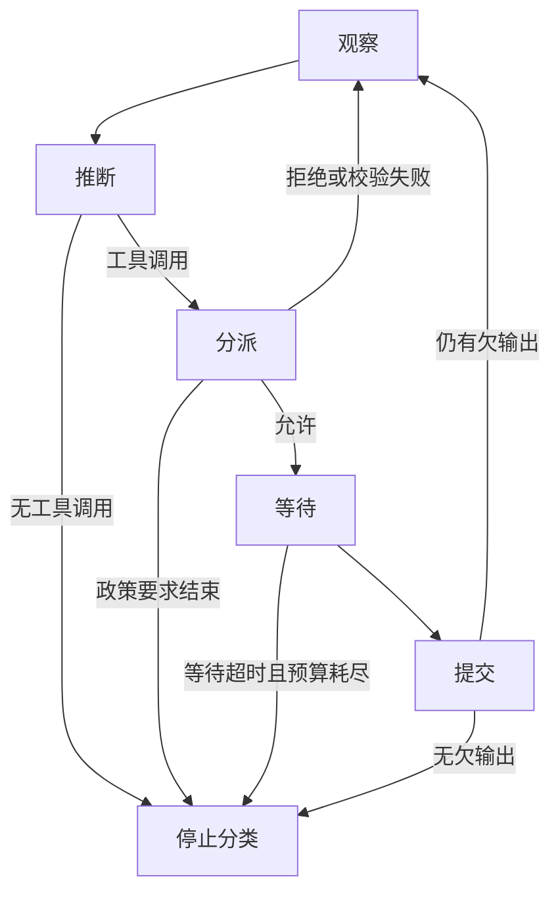
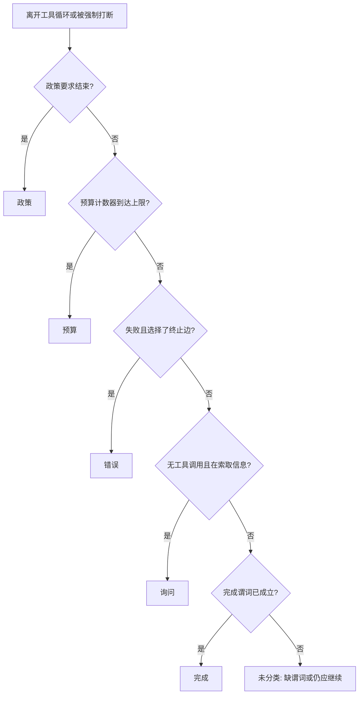
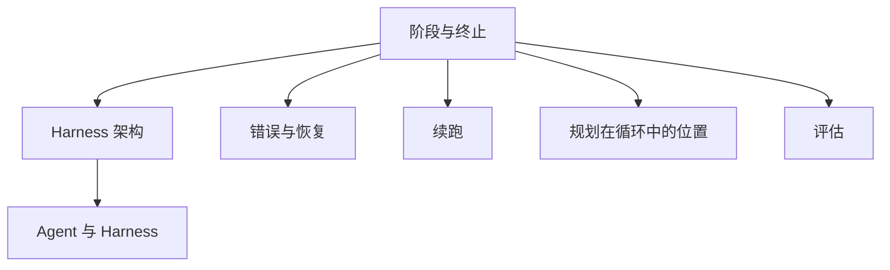

# 执行循环的阶段与终止

## 摘要

执行循环把一次模型—工具迭代分成五个阶段：观察、推断、分派、等待、提交。循环离开这五个阶段时，必须写下五类停止原因之一：完成、询问、预算、错误、政策。阶段规定控制流的位置。停止原因规定控制为何交还调用方。只把“模型不再调用工具”记为完成，会把提问、预算耗尽、不可恢复错误和政策中止写成同一种结局。一步在六个维度中的位置见 [Harness 架构](../架构/Harness架构.md)。错误之后回到观察还是进入终止，其转移细节留给索引中的「错误与恢复」。

## 范围与材料

五个阶段对应 Meng 等预印本为执行循环给出的状态：观察、调用模型、分派工具、等待工具结果、提交状态，另有空闲和终止。该文于 2026-04-28 以 v3 发布，页面标明尚未同行评审；转移函数的排版以 PDF 为准 [1][2]。五类停止是本仓库对终止边上可观察原因的划分，用于填写轨迹。它不是预印本中的原表。

产品材料只用来核对某一类停止是否已经公开，不重复 [Harness 架构](../架构/Harness架构.md) 的结构比较。Codex 的回合终止依据 Bolin 2026-01-23 的循环说明，批准暂停依据 Chen 2026-02-04 的 App Server 说明 [3][4]。DeepSeek Harness 的 step 与 turn 依据其架构文档；该仓库标明开发者预览 [5][6]。Hermes Agent 的迭代上限依据 `main` 分支的循环文档，默认值可被配置覆盖 [7]。Cursor 的 `stop` 钩子依据其 Hooks 文档 [8]。

---

## 1. 它为什么存在

模型接口的一次调用在返回文本或工具调用后结束。多步任务还要求外层决定是否把工具结果送回、是否把副作用当作已提交，以及把控制交还用户时属于哪一种结局。没有阶段划分时，超时、拒绝和正常结束都表现为“循环停了”。没有停止分类时，轨迹只能保存最后一条助手消息，外部程序不能区分任务完成、向用户提问、预算用尽、错误终止和政策中止。

Meng 等把安全性定义为不存在无法到达终止的状态，把活性定义为每个可达的非终止状态都能到达终止 [1]。这两项性质约束的是边上要有后继。它们不规定后继边上的原因字符串。原因字符串是评估接口要消费的字段：同一次终止，完成和错误对回归测试的含义不同。本文固定五个阶段和五类原因，使该字段有稳定的取值。

---

## 2. 五个阶段

一次用户回合可以包含多个模型—工具迭代。一个阶段是其中一轮迭代内部的一个状态，不是用户回合本身。Codex 把用户输入到终止消息称为 turn，其中可以包含多次推断 [3]。DeepSeek Harness 把一次模型请求及其工具调用称为 step，把从领取输入到不再欠输出称为 turn [6]。本文的阶段位于 step 之内。

| 阶段 | 进入条件 | 本阶段产生的记录 | 离开时的后继 |
| --- | --- | --- | --- |
| 观察 | 存在尚未消费的用户输入、工具结果或注入上下文 | 当步视图的组成：保留了哪些字段、外置了哪些字段 | 推断；若领取的输入被拒绝且本回合尚无步，可以直接终止 |
| 推断 | 视图已经组装，模型请求已经绑定 | 模型标识、停止标记、助手消息或工具调用 | 无工具调用则进入停止分类；有工具调用则进入分派 |
| 分派 | 存在尚未执行的工具调用 | 工具名、参数、模式校验结果、行动前钩子的决定 | 允许则进入等待；拒绝或校验失败则把该结果作为观察，或在政策要求结束时终止 |
| 等待 | 工具已经启动，或批准请求已经发出且尚未答复 | 开始时间、超时、取消、批准决定 | 结果或错误返回后进入提交；等待本身超时且预算耗尽则终止 |
| 提交 | 工具结果或错误已经返回 | 哪些副作用写入了可恢复状态，哪些只留在消息里 | 仍有未消费结果或新输入则回到观察；否则进入停止分类 |

观察阶段包含领取输入和组装视图。上下文管理决定视图的内容，执行循环决定何时允许推断开始。推断开始之后，本步的视图不再被同一轮的迟到消息改写；新输入进入下一次观察。DeepSeek Harness 把这一约束写成：取消发生在准备调用期间时，系统提示和已接受的用户消息都不提交 [6]。

分派不执行副作用。它只做解析、校验和行动前决定。等待才持有正在运行的进程或尚未返回的批准。把二者并成一个“工具”状态，会使超时没有独立的边：校验失败和进程挂起看起来相同。

提交只记录已经成立的事实。工具进程仍在运行时写入的检查点，不能作为下一步的观察来源。该依赖的一般形式见 [Harness 架构](../架构/Harness架构.md) 第 3.2 节。



实线是阶段转移。停止分类不是第六个执行阶段。它读取最后一条转移，给本回合指定第 3 节的一类原因。

---

## 3. 五类终止

### 3.1 取值

终止记录至少包含原因类、触发阶段和证据指针。五类互斥。一条终止只取一类。若多个条件同时成立，按第 3.2 节的顺序判定。

| 原因 | 判定条件 | 典型证据 | 不记入本类的相邻情况 |
| --- | --- | --- | --- |
| 完成 | 循环不再调用工具，并且 Harness 的完成谓词成立 | 谓词名称及其结果，例如测试通过、调用方确认接受最终消息 | 模型只说已经完成，而谓词尚未执行 |
| 询问 | 推断没有工具调用，消息向用户索取继续所必需的信息，完成谓词未要求本回合结束 | 问题所指向的缺失字段 | 模型在工具结果之间输出的进度说明 |
| 预算 | 步数、时间或费用到达循环写下的上限 | 上限的种类、配置值和触发时的计数 | 上下文压缩。压缩之后循环继续，见 Codex 的自动压缩 [3] |
| 错误 | 分派、等待或提交出现失败，且循环选择终止边而不是回到观察 | 失败种类：校验、超时、非零退出、提交失败 | 同一失败被写成工具观察并再次推断。该转移属于「错误与恢复」 |
| 政策 | 用户中止、终止钩子或规则要求结束本回合，且该决定独立于完成谓词 | 政策标识、钩子或批准的决定 | 批准拒绝后把拒绝文本送回模型。此时阶段回到观察，Codex 的批准请求会暂停回合直至答复，答复本身还不是终止类 [4] |

完成谓词由任务规定，不由助手消息的语气规定。Bolin 写明，Codex 在模型不再发出工具调用并产生助手消息时结束回合；这段消息可以是对原请求的答复，也可以是向用户追问。工作区中的修改常常才是软件任务的主要产物 [3]。因此，Codex 的助手消息只说明推断阶段离开了工具循环。它是完成还是询问，还要看消息是否在索取继续所需的信息，以及仓库测试等谓词是否被当作完成条件。谓词未运行时，原因类不能写成完成。

询问结束的是当前回合，不是整个任务。用户的下一条消息开始新的观察。若产品把追问自动改写成继续推断，则当前记录不应使用询问，而应保留在观察。

预算必须是循环自己的计数器。Hermes Agent 的文档给出父循环默认 500 次迭代、子代理默认 50 次；到达上限后停止并返回已做工作的摘要 [7]。子代理的上限耗尽终止的是子循环。父循环是否随之终止，取决于父循环是否把该结果当作观察。上下文窗口达到压缩阈值不是预算终止：Codex 在超过 `auto_compact_limit` 后替换输入并继续 [3]，DeepSeek Harness 的回合在仍有欠输出时进入下一步 [6]。

错误类只覆盖选择了终止边的失败。Meng 等要求错误输入也有转移，否则终止不可达 [1]。回到观察的错误满足这一要求，但原因类不是错误。只有循环不再继续时，轨迹才写错误。超时、非零退出、校验失败和拒绝批准各自回到哪一条边，留在索引的「错误与恢复」，以免把阶段合同和恢复策略写进同一张表。

政策类覆盖不经过完成谓词的强制结束。DeepSeek Harness 的 `agent/turn-stopping` 可以停止回合；无待处理输出时的 `turn/end` 则进入停止分类，本身不指定五类中的哪一类 [6]。Cursor 的 `stop` 钩子在 Agent 完成时运行，可以观察该次完成；文档还提供会话和工具阶段上的阻断钩子 [8]。钩子在完成之后运行，不把完成改写成另一类；钩子若在工具前拒绝并结束整个回合，原因类是政策。

### 3.2 同时成立时的顺序

一条转移上可能同时看见助手消息和预算耗尽，或同时看见工具失败和用户中止。分类按下列顺序取第一个成立的条件，使轨迹只有一个原因类。

1. **政策。** 用户中止、终止钩子或规则已经要求结束。
2. **预算。** 循环的步数、时间或费用计数器已经到达上限。
3. **错误。** 循环已经选择失败上的终止边。
4. **询问。** 推断没有工具调用，且消息索取继续所必需的信息。
5. **完成。** 完成谓词成立。谓词未执行时，不降级为完成，记录保持未分类，并标明缺谓词。

这个顺序把 Harness 的强制结束放在模型语气之前。模型在预算已经耗尽的同一步写出“已完成”，原因类仍是预算。



### 3.3 阶段与原因的对应

不是每个阶段都能产生每一类原因。下表给出本仓库允许的触发阶段。实现若在其他阶段写出某一类，应视为记录错误，而不是新的原因。

| 原因 | 允许的触发阶段 |
| --- | --- |
| 完成 | 推断之后的停止分类；提交确认谓词之后 |
| 询问 | 推断之后的停止分类 |
| 预算 | 观察、推断、分派、等待、提交中计数器到达上限的那一阶段 |
| 错误 | 分派、等待、提交 |
| 政策 | 观察、分派、等待，以及专门的终止钩子 |

完成不从等待阶段直接写出。等待期间测试进程结束，应先提交该进程的结果，再由停止分类读取谓词。这样，轨迹中的完成总有一份已经提交的谓词结果，而不是一条尚在运行的命令。

---

## 4. 边界与代价

### 4.1 适用条件

五个阶段和五类原因用于：

- 为一次回合填写轨迹中的 `phase` 与 `stop_reason`；
- 判断助手消息是完成、询问，还是尚未分类；
- 把压缩、批准暂停和拒绝后的再推断排除出终止统计。

### 4.2 不适用条件

- 五类原因不描述失败之后如何重试。超时回到观察、非零退出如何转移、校验失败和拒绝批准是否终止，属于索引中的「错误与恢复」。
- 模型过早给出完成语气时，是否拦截并继续，属于索引中的「续跑」。本文只要求此时不要把原因写成完成，除非完成谓词已经成立。
- 计划文件是状态，计划提醒是上下文。计划步骤的推进不是第六类停止，相关主题在索引的「规划在循环中的位置」。
- Hermes 的 500 与 50 是文档默认值 [7]。DeepSeek Harness 的事件名处于开发者预览，可能随提交变化 [5][6]。
- Cursor 的 `stop` 钩子证明完成边界上可以插入脚本 [8]。它不证明五类原因都已作为枚举出现在 Cursor 的轨迹模式中。

### 4.3 代价

| 做法 | 获得的记录 | 留下的问题 |
| --- | --- | --- |
| 只保存最后一条助手消息 | 实现短 | 完成、询问、预算、错误和政策不可区分 [3] |
| 把任意无工具调用都记为完成 | 终止边唯一 | 追问和未运行的测试被计为成功 [3] |
| 把压缩或批准等待记为终止 | 长操作在日志中可见 | 仍在继续的回合被计为结束 [3][4] |
| 为五类都保留终止边 | 回归可以按原因过滤 | 每一步都要维护计数器、谓词结果和政策标识 |

强制分类也有误记的可能。顺序把政策放在完成之前，因此用户在谓词即将成立时中止，记录为政策。这是分类合同，不是任务成败的业务结论。业务结论应另读谓词结果。

---

## 5. 可验证的分类

下列函数按第 3.2 节的顺序给一条已经离开工具循环的记录分类。`predicate` 只接受 `pass`、`fail` 和 `not_run`。函数不调用模型。

```python
def classify_stop(record: dict) -> str:
    if record.get("policy_stop"):
        return "政策"
    if record.get("budget_exhausted"):
        return "预算"
    if record.get("failure_terminal"):
        return "错误"
    if record.get("awaiting_user") and not record.get("tool_calls"):
        return "询问"
    if record.get("predicate") == "pass" and not record.get("tool_calls"):
        return "完成"
    if record.get("predicate") == "not_run" and not record.get("tool_calls"):
        return "未分类"
    raise SystemExit("记录仍在工具循环中，或字段不足")


samples = [
    {"name": "测试已通过且无后续工具调用", "predicate": "pass", "tool_calls": False},
    {"name": "模型追问缺失参数", "awaiting_user": True, "tool_calls": False, "predicate": "not_run"},
    {"name": "迭代计数到达上限", "budget_exhausted": True, "predicate": "not_run", "tool_calls": False},
    {"name": "等待超时后选择终止", "failure_terminal": True, "predicate": "not_run"},
    {"name": "用户中止", "policy_stop": True, "predicate": "pass", "tool_calls": False},
    {"name": "模型宣布完成但谓词未运行", "predicate": "not_run", "tool_calls": False},
]
for sample in samples:
    name = sample.pop("name")
    print(name, "->", classify_stop(sample))
```

人工核对时看三个字段即可。

1. 轨迹里的最后一个阶段是观察、推断、分派、等待还是提交。
2. `stop_reason` 是否属于完成、询问、预算、错误、政策。完成是否带有谓词结果，而不是只带助手消息 [3]。
3. 压缩事件和尚未答复的批准是否被排除在 `stop_reason` 之外 [3][4]。

---

## 6. 关联



- **Harness 架构**：阶段在六维中的位置、三组依赖和五个产品的循环载体见 [Harness架构](../架构/Harness架构.md)。
- **错误与恢复**：校验失败、超时、非零退出和拒绝批准的非终止边。本文只规定何时把它们写成错误类。
- **续跑**：完成谓词未成立时拦截模型的结束语气。本文要求该情况保持未分类或继续观察。
- **规划在循环中的位置**：计划是状态，提醒是上下文。计划耗尽不是独立的停止类。
- **评估**：原因类是轨迹字段。只有最终回复时，评估接口至多为部分具备，见 [Agent与Harness基本原理](../../基础概念/Agent与Harness基本原理.md)。

---

## 7. 延伸阅读

- 本仓库：[Harness 架构](../架构/Harness架构.md)；索引见 [`README.md`](../../README.md) 的「运行时 / 执行循环」。
- 终止必须可达：Meng 等预印本对执行循环的形式语义 [1]。
- 助手消息、追问与压缩：Bolin [3]。
- 批准作为回合内的暂停：Chen [4]。

---

## 参考文献

1. Meng, Q., Wang, Y., Chen, L., Li, Y., Wu, W., Jiang, W., Wang, Q., Lu, C., Gao, Y., Wu, Y., and Hu, Y. *Agent Harness for Large Language Model Agents: A Survey*. Preprints.org, manuscript 202604.0428, v3, posted 2026-04-28. 页面标明尚未同行评审。观察、调用模型、分派、等待工具结果、提交和终止这一状态集合，以及错误必须有转移的要求，来自该预印本对执行循环的形式化。链接：<https://www.preprints.org/manuscript/202604.0428>
2. Awesome-Agent-Harness. 综述作者维护的仓库，含论文 PDF。转移函数的排版以所读 PDF 为准。链接：<https://github.com/Gloriaameng/Awesome-Agent-Harness>
3. Bolin, M. *Unrolling the Codex agent loop*. OpenAI, 2026-01-23. 说明一次用户回合内的多次推断、无工具调用的助手消息作为回合终止信号、该消息可以是答复或追问，以及超过阈值后的自动压缩。链接：<https://openai.com/index/unrolling-the-codex-agent-loop/>
4. Chen, C. *Unlocking the Codex harness: how we built the App Server*. OpenAI, 2026-02-04. 说明批准是服务器发起的请求，回合在客户端允许或拒绝之前暂停。链接：<https://openai.com/index/unlocking-the-codex-harness/>
5. DeepSeek-AI. *DeepSeek Harness: Everything is a Plugin*. GitHub 仓库 `README.md`。标明开发者预览和不兼容变更。链接：<https://github.com/deepseek-ai/deepseek-harness>
6. DeepSeek-AI. *DeepSeek Harness Architecture*. 仓库文件 `docs/architecture.md`。step 与 turn、`turn/end`、`agent/turn-stopping`，以及准备调用被取消时不提交消息，来自该文。引用时注明所读提交。链接：<https://github.com/deepseek-ai/deepseek-harness/blob/master/docs/architecture.md>
7. Nous Research. *Agent Loop Internals*. Hermes Agent 文档，`main` 分支。父循环与子代理的默认迭代上限，以及到达上限后的停止。链接：<https://hermes-agent.nousresearch.com/docs/developer-guide/agent-loop> ；仓库副本：<https://github.com/NousResearch/hermes-agent/blob/main/website/docs/developer-guide/agent-loop.md>
8. Cursor. *Hooks*. 在线文档。`stop` 在 Agent 完成时运行；工具前钩子可以阻断调用。引用前核对当前页面。链接：<https://cursor.com/docs/hooks>

### 图片来源与许可声明

本文图示均为 Mermaid，在 Markdown 渲染时生成。未从论文或产品文档下载原图。Meng 等预印本中的转移系统图、OpenAI 文章中的循环图，以及 Cursor、DeepSeek、Hermes 文档中的结构图，版权归原作者或出版方。阅读原图请使用上文链接。

| 图 | 位置 | 类型 | 说明 |
| --- | --- | --- | --- |
| 五阶段及停止分类 | 第 2 节 | Mermaid flowchart | 自绘。阶段对应文献 [1] 的状态，停止分类是本仓库的记录合同 |
| 五类原因的判定顺序 | 第 3.2 节 | Mermaid flowchart | 自绘。顺序为本仓库的分类合同；助手消息与压缩的事实依据文献 [3][4] |
| 在知识网络中的位置 | 第 6 节 | Mermaid flowchart | 自绘，对应 `README.md` 的「运行时 / 执行循环」 |

自绘图表示本篇的结构，不表示原作者认可该画法。
