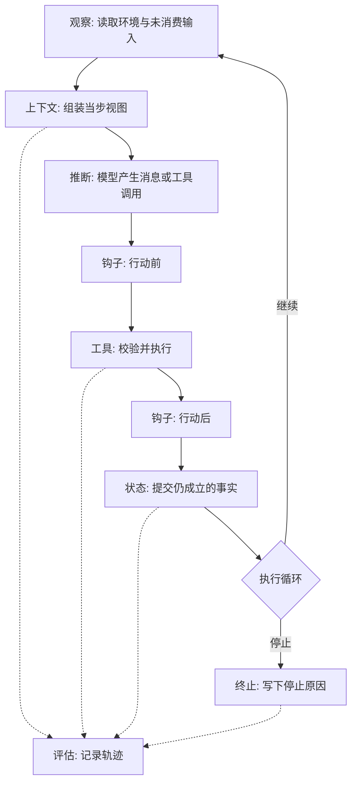
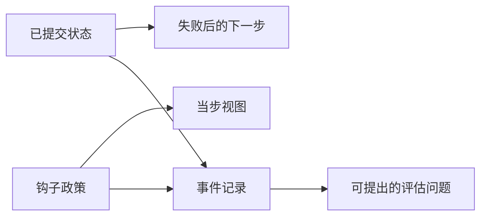
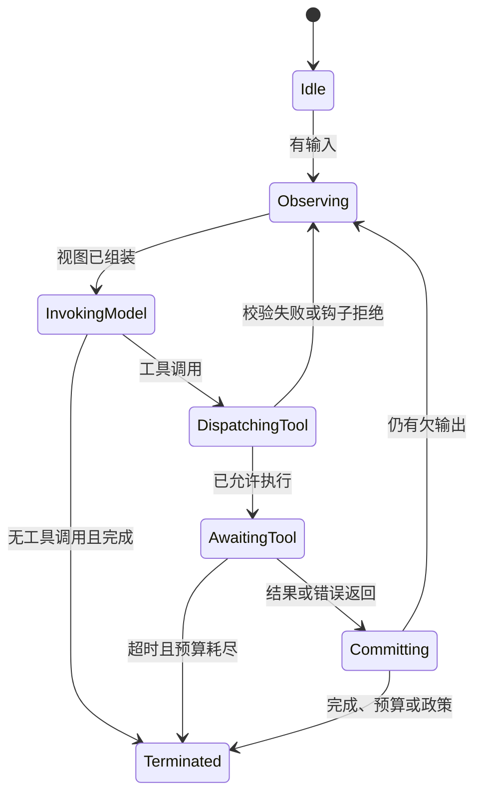
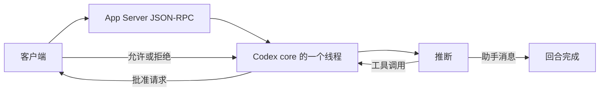
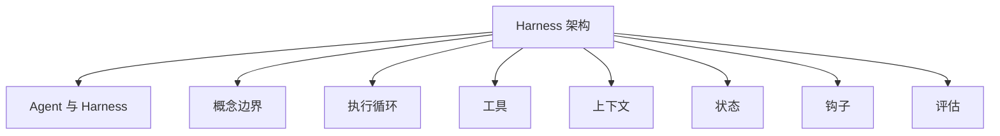

# Harness 架构

## 摘要

Harness 架构描述一次行动如何穿过上下文、模型、工具、状态和钩子，并在何种条件下结束。本文把该结构写成一步数据流、三组实现依赖、任务对组件的压力，以及执行循环作为带标签转移系统的三项性质。随后用同一组问题比较五份公开实现：Claude Code、Codex、Cursor、DeepSeek Harness 与 Hermes Agent。比较的对象是结构选择，包括循环是否单独成协议、模型可见历史是否由日志投影、扩展点是配置文件还是可卸载插件、隔离边界落在进程还是虚拟机。成熟度档位的定义见 [Agent 与 Harness](../../基础概念/Agent与Harness基本原理.md)。

## 范围与材料

执行循环的状态集合与安全性、活性、确定性，依据 Meng 等预印本对 \(E\) 的形式化讨论。该文于 2026-04-28 以 v3 发布，页面标明尚未同行评审；转移函数的排版以 PDF 为准 [1][2]。六维之间的依赖见同文，本仓库的转写见 [Harness 概念边界](../../基础概念/Harness概念边界.md)。

五个产品的材料相互不可替代，版本也不同。

| 产品 | 本文使用的材料 | 材料边界 |
| --- | --- | --- |
| Claude Code | 产品概述与术语表。概述写明终端、IDE、桌面和 Web 连接同一引擎 [3]；术语表定义 agentic harness [4] | 闭源。概述没有给出可检验的状态机。钩子事件表以在线文档为准，本文不转写未核对的事件名。链接：<https://code.claude.com/docs/en/hooks> |
| Codex | Bolin 对智能体循环的说明，2026-01-23 [5]；Chen 对 App Server 的说明，2026-02-04 [6] | 2026-02-04 的文字把 TUI 描述为仍与核心同进程，并计划改为 App Server 客户端。此后是否完成迁移，需核对仓库 |
| Cursor | Agent 概述、Rules、Hooks、Cloud Agents 及其安全说明 [7][8][9][10][11] | 在线文档。概述的三分法窄于钩子文档所暴露的控制面 |
| DeepSeek Harness | 仓库 `README.md` 与 `docs/architecture.md` [12][13] | 文档标明处于开发者预览，并警告存在不兼容变更。Cordis 只按该架构文档所使用的部分引用 [14] |
| Hermes Agent | 架构总图、智能体循环与记忆文档，均取自仓库 `main` [15][16][17] | 未固定发行版本。默认阈值可被配置覆盖 |

公开分数、界面截图和未写入上述材料的内部调度，不进入比较。

---

## 1. 它为什么存在

索引中的一步执行、职能依赖、任务压力和循环的形式性质描述的是同一个对象。分开写成四篇，会使“组视图”和“状态机”看起来像两套机制。它们是同一次转移的数据面和性质。

模型调用本身没有回合、工具结果和提交点。外层若只保存消息并再次调用模型，得到的是对话循环。软件修改还要求：工具参数先被校验，高权限行动可被拒绝，副作用与检查点对齐，停止原因可被外部程序读取。这些要求分别落在工具、钩子、状态和评估接口上。架构文档的任务是规定它们的先后关系，使一次失败能够定位到某次转移，而不是只得到最终回复。

Meng 等把执行循环刻画为带标签的转移系统。状态集合为：空闲、观察、调用模型、分派工具、等待工具结果、提交状态、终止。可观察事件包括模型响应、工具调用、工具结果、人工批准和错误。该形式化给出三项性质：安全性，即不存在无法到达终止的状态；活性，即每个可达的非终止状态都能到达某个终止状态；确定性，即转移是函数，环境的非确定性被限制在工具调用边界 [1]。预印本同时写明，当时的生产 Harness 尚未普遍把该状态机暴露给部署前检查，也未对其多代理同步给出无死锁证明 [1]。因此，下文的产品比较记录公开结构，不把任一产品记为已经满足该形式条件。

---

## 2. 组成部分

本仓库用 \(H=(E,T,C,S,L,V)\) 记录成熟度。架构上，这六项是一次转移中的六个位置，而不是六个可以任意堆叠的模块名。

| 组成部分 | 在一步中的位置 | 它保存或改变的对象 |
| --- | --- | --- |
| 执行循环 \(E\) | 决定下一步进入观察、推断、分派、等待、提交或终止 | 当前状态、停止原因、剩余预算 |
| 工具注册表 \(T\) | 把模型输出解析为工具名和参数，并路由到实现 | 模式、实现、调用结果 |
| 上下文管理 \(C\) | 在推断前组装这一步的视图 | 指令、记忆投影、工具模式、当步观察 |
| 状态存储 \(S\) | 在副作用成立后提交仍可恢复的事实 | 会话日志、工作区、检查点 |
| 生命周期钩子 \(L\) | 在推断、工具和终止的边界上执行策略 | 允许、拒绝、改写或插入的上下文 |
| 评估接口 \(V\) | 旁路记录上述事件 | 可供外部程序比较的轨迹 |

环境、观测、治理和编排是这些位置的部署落点，不另设评分字母。字母对照见 [Harness 概念边界](../../基础概念/Harness概念边界.md)。



实线是控制流。虚线是旁路记录。模型不直接写入工作区，也不决定进程中断后从哪一份提交恢复。该分工与 [Agent 与 Harness](../../基础概念/Agent与Harness基本原理.md) 第 2.1 节一致。

---

## 3. 组件如何交互

### 3.1 一步

一次用户回合可以包含多个模型—工具迭代。架构上仍把其中一轮写成同一步，以免把“回合”“迭代”和“工具调用”混成一个计数器。

1. **领取输入。** 循环从收件箱或用户消息取出尚未消费的输入。没有可执行输入时，这一步不调用模型。
2. **组装视图。** 上下文管理根据预算选择指令、状态投影、工具模式和上一步观察。钩子可以在组装期间插入或删除材料。
3. **推断。** 模型返回给用户的消息，或返回一个或多个工具调用。前者是终止候选；后者进入分派。
4. **分派。** 工具注册表校验名称和参数。行动前钩子可以允许、拒绝或改写。拒绝应作为观察返回，而不是使转移无定义。
5. **执行并等待。** 工具实现产生结果或错误。等待工具结果是独立状态：超时和取消必须有转移。
6. **提交。** 只有已经成立的副作用写入可恢复状态。提交失败时，下一步观察到的是失败，而不是一份被当作成功的检查点。
7. **转移。** 若仍有未完成的工具结果或新的输入，回到领取输入。若完成条件、预算、错误或政策给出停止，写入停止原因并终止。

Codex 把一次用户输入到终止消息称为一个 turn，其中可以包含多次推断与工具迭代 [5]。DeepSeek Harness 把一次模型请求及其工具调用称为 step，把从领取输入到不再欠输出称为 turn [13]。两套命名都把“用户回合”和“模型—工具迭代”分开。本文的一步对应后者。

### 3.2 三组实现依赖

Meng 等指出，六项在实现中有向依赖，讨论时的正交划分只是分析上的方便 [1]。对架构有直接后果的是三组。

| 依赖 | 机制 | 架构后果 |
| --- | --- | --- |
| 循环依赖状态 | 失败后的恢复由失败前已经提交的事实决定 | 工具执行中的崩溃若尚未提交，重启不得把未完成写入当作已完成 |
| 上下文依赖钩子 | 进入窗口的内容受政策约束，压缩和检索决定实际进入的部分 | 钩子拒绝的材料不应在同一步被上下文管理重新注入 |
| 评估依赖前序记录 | 能够提出的问题不超过已经记录的字段 | 只有操作日志时，可以证明某次调用发生，不能直接比较轨迹 |

因此，先把执行循环标为已具备、而提交点仍与副作用不一致，状态上的同一次失效仍然存在。评分程序见 [Agent 与 Harness](../../基础概念/Agent与Harness基本原理.md) 第 5 节。



### 3.3 任务压力

任务类型改变的是哪些组件成为必需，变化不随对话长度线性增加。下表依据综述的任务分类 [1]，并写出架构上因此必须存在的转移。

| 任务 | 升高的组件 | 架构上必须存在的转移 |
| --- | --- | --- |
| 单轮问答 | 上下文低，工具可无 | 推断后可以直接终止 |
| 多步检索 | 上下文高，状态弱 | 检索结果进入下一步视图；窗口预算耗尽时有压缩或停止 |
| 软件修改 | 六项都高 | 工作区是状态，测试是完成信号，命令在执行前可被拒绝 |
| 长期助理 | 状态和钩子在上线后成为必需 | 会话可恢复；记忆晋升有单独条件 |
| 多代理 | 工具包含对其他执行者的调用 | 子执行者有独立上下文和预算；父循环能接收其终止 |
| 具身或图形界面 | 工具是传感和执行器 | 观察与行动的延迟进入等待状态，取消有转移 |

软件修改是五份产品的共同主场景。若工作区提交或执行前拦截仍由调用方补齐，产品的运行时形态接近带工具的对话。模型是否生成计划不构成这一界限 [1]。

### 3.4 循环的形式性质

把第 3.1 节的步骤写成状态机之后，错误和预算才有位置。



三项性质对应该图中的结构约束 [1]。

- **安全性。** 错误输入也有出边。校验失败、钩子拒绝、工具超时和非零退出都回到观察或进入终止。没有对应转移的错误会使终止不可达。
- **活性与预算。** 步数、时间或费用至少有一个有限上限。到达上限时进入终止，并写下预算这一停止原因。只有“模型宣布结束”的循环不满足该条件。
- **工具边界上的确定性。** 模型采样和外部进程可以不确定。同一次运行的可重复性要求：给定已经提交的状态和同一次工具结果，下一步转移唯一。工具结果本身被记入轨迹，而不是被重新采样进转移函数。

预印本把多代理同步的无死锁留给进程代数，并指出这仍是研究与工程之间的缺口 [1]。五个产品的公开文档都描述了子代理或并行会话，都没有在本文使用的材料中给出可机械检查的无死锁证明。

---

## 4. 五个产品

### 4.1 对照

下表只记录材料中能够定位的结构。空缺表示该材料没有把对应机制写成架构事实，不表示实现中一定不存在。

| 结构问题 | Claude Code [3][4] | Codex [5][6] | Cursor [7][9][10][11] | DeepSeek Harness [12][13] | Hermes Agent [15][16][17] |
| --- | --- | --- | --- | --- | --- |
| 循环的载体 | 多表面共用一个引擎；术语表写明由循环把行动串起来 | Codex core 中的循环；App Server 以线程、回合、条目暴露它 | 概述将 Agent 定义为指令、工具和模型；钩子文档暴露循环阶段 | `ctx.agentLoop` 是可替换插件；step 与 turn 分开 | `AIAgent` 的 `run_conversation`；CLI、网关、ACP、定时任务共用 |
| 模型可见历史 | `CLAUDE.md` 或 `AGENTS.md` 在会话开始读入；另有自动记忆 | 开发者消息、用户指令、技能元数据和环境上下文按固定顺序进入输入；历史随回合增长 | Rules、用户规则、团队规则和 `AGENTS.md` 提供持久指令 | 会话日志是来源；`deriveMessages()` 从日志投影 | 内部使用 OpenAI 式消息；系统提示按稳定、上下文、易变三层组装 |
| 提交与恢复 | 概述写明会话可在表面之间迁移；提交协议未在概述中形式化 | 线程持久化事件史，客户端可重连；压缩替换输入列表 | 云端保存对话、元数据和产物；虚拟机按生命周期休眠后删除 | 追加写的 `SessionEvent`；未结算的流在进程丢失后没有耐久尝试 | SQLite 会话，压缩产生子谱系；记忆在压缩前先落盘 |
| 扩展 | MCP、技能、钩子、子代理、Agent SDK | MCP 与技能进入同一政策；壳与文件工具由核心提供 | 钩子脚本、MCP、规则；云端可跑仓库内命令式钩子 | 插件向共享上下文注册服务、事件和可撤销效应 | 工具在导入时注册；插件可提供工具、钩子、记忆和上下文引擎 |
| 行动前控制 | 钩子可在行动前后运行命令；SDK 可控制工具与权限 [3] | 服务器可发起批准请求并暂停回合 [6]；沙箱说明只约束核心 `shell` 工具 [5] | `beforeShellExecution`、`preToolUse` 等可观察、阻断或改写 [9] | `tools/pre-execute` 位于执行前；`ctx.sandbox` 在生成进程前包装参数 [13] | 危险命令经 `approval_callback`；插件有工具前钩子 [16] |
| 隔离 | 概述区分本机、桌面和云端定时任务，未在本文材料中给出虚拟机规格 | Web 在容器内启动 App Server [6]；自托管执行器另见集成文档，不并入本表 | 每个云端 Agent 一台虚拟机，运行在基于 Firecracker 的 microVM 上，与其他生产账户分开 [11] | 文件系统与子进程指向同一执行世界；换成远程沙箱时 Bash、PTY 和 LSP 一起迁移 [13] | 终端后端包括本地、Docker、SSH、Daytona、Modal、Vercel，另有插件后端 [15] |
| 停止 | 概述未列出停止原因枚举 | 不再发出工具调用的助手消息结束回合 [5]；压缩用于避免窗口耗尽 | `stop` 钩子在完成时运行 [9]；云端回合在空闲后回收虚拟机 [11] | 无待处理输出时 `turn/end`；`agent/turn-stopping` 可停止回合 [13] | 默认父循环 500 次、子代理 50 次，到达上限后返回已做工作的摘要 [16] |

### 4.2 Claude Code

Claude Code 的术语表把 agentic harness 定义为工具、上下文管理和执行环境，以及把行动串起来的循环。Claude Code 是 Harness，Claude 是其中的模型。该条目列出的供应物包括文件访问、shell、权限门控和记忆加载 [4]。产品概述补充：终端、IDE、桌面应用和 Web 连接同一引擎，因此仓库中的 `CLAUDE.md`、设置和 MCP 服务器跨表面生效。若仓库已有 `AGENTS.md`，它可以代替 `CLAUDE.md`。自动记忆在工作过程中保存跨会话习得。技能包装可复用流程。钩子在行动前后运行 shell。子代理由主代理分派，Agent SDK 把同一套工具和权限交给外部编排 [3]。

该公开结构的特点是引擎与表面分离：迁移会话、云端定时任务和本机桌面任务改变的是入口与运行位置，不要求为每个表面重写循环。代价是概述没有公开第 3.4 节的状态集合。权限门控和钩子被确认为存在，事件顺序和拒绝是否总是回到观察，仍要对照钩子与权限的在线文档，而不能从概述推出。闭源还使文档与部署可能不一致；Meng 等在给商业系统编码时已经标明这一限制 [1]。

### 4.3 Codex

Bolin 描述的循环是：组装输入，推断，若模型请求工具则执行并把结果追加到输入，再次推断，直到模型不再发出工具调用、而是产生给用户的助手消息。该消息是回合的终止信号。主要产物经常是工作区中的修改，而不是这段消息本身。一次用户回合可以包含很多次推断。上下文窗口同时计入输入和输出，因此压缩是循环的职责 [5]。

输入在用户消息之前按固定层插入：只描述核心 `shell` 工具沙箱的开发者消息，可选的 `config.toml` 开发者指令，从 `AGENTS.md` 等文件聚合的用户指令，已配置技能的元数据，以及当前工作目录和 shell 的环境上下文。沙箱说明不覆盖 MCP 工具，后者自行实施约束。沙箱配置、批准模式或工作目录变化时，插入新的开发者或用户消息，以避免静默改变前缀。工具列表的不稳定排序会造成提示缓存失效 [5]。自动压缩在超过 `auto_compact_limit` 后调用 Responses API 的压缩端点，用较短的输入列表替换原输入，其中包含带 `encrypted_content` 的压缩条目，用于保留模型对原对话的潜在表示 [5]。

Chen 说明，同一核心被 App Server 暴露给 CLI、IDE、桌面和 Web。一个进程包含标准输入读取器、消息处理器、线程管理器和每线程一个的核心会话。协议原语是条目、回合和线程。条目有开始、可选增量和完成。批准是服务器发起的请求，回合在客户端允许或拒绝之前暂停。Web 在装有工作区的容器内启动同一二进制，浏览器不保存长期任务的事实来源。2026-02-04 的记录写明，TUI 当时仍与循环同进程，并计划改为 App Server 的普通客户端 [6]。

该结构把循环做成可嵌入的运行时，并把批准放进协议而不是只放进提示。代价有三项。MCP 工具位于核心沙箱之外，策略边界不自动覆盖全部效应器 [5]。压缩用新输入替换旧输入，除加密的潜在条目外，被替换的文本不再作为逐步历史存在 [5]。缓存对工具顺序和沙箱文本敏感，使“语义等价的工具格式”成为架构约束，而不只是性能细节 [5]。



### 4.4 Cursor

Cursor 的 Agent 概述把 Agent 定义为三部分：系统提示与规则、工具、所选模型 [7]。规则分为项目规则、用户规则、团队规则和 `AGENTS.md`，用于向模型提供持久指令 [8]。这是上下文层的组装接口。

钩子文档把控制面写得更细。钩子是在循环阶段前后启动的进程，经标准输入输出交换 JSON，可以观察、阻断或改写行为。与架构直接相关的阶段包括会话开始和结束、工具前后、shell 前后、MCP 前后、读文件前、文件编辑后、提交提示前、压缩前、子代理开始和结束，以及 `stop` [9]。云端 Agent 使用仓库中的 `.cursor/hooks.json`。早期只读探索回合不运行钩子，钩子在环境可写之后开始。对后端执行的 HTTP MCP，`preToolUse` 可以拒绝调用，但更新后的输入被忽略；`postToolUse` 收到的是脱敏结果，不能用它替换工具输出 [9]。

云端执行的生命周期在安全说明中写成六段：启动、为该 Agent 准备隔离虚拟机并克隆仓库、在虚拟机内运行并回传、把对话和产物存入托管存储、推送分支并打开拉取请求、空闲后休眠并删除虚拟机。隔离单位是每 Agent 一台虚拟机，运行在基于 Firecracker 的 microVM 上，与 Cursor 其余生产账户分开 [10][11]。

该结构的特点是把策略做成可替换脚本，并把云端隔离做成虚拟机而不是进程约定。代价也来自这两点。概述的三分法不包含状态机和停止原因，阅读者若只停留在概述，会把钩子误认为可选插件，而不是循环边界。云端的只读起步阶段没有钩子，因此探索回合的工具使用不受仓库钩子约束 [9]。HTTP MCP 的钩子不能改写输入和完整输出，政策在这条路径上弱于本地工具 [9]。用户主目录中的钩子不会进入云端虚拟机 [10]。

### 4.5 DeepSeek Harness

DeepSeek Harness 在仓库中自述为 DeepSeek AI 的开源 Harness，架构原则是一切皆插件，底层框架为 Cordis。README 标明开发者预览，并警告将出现不兼容变更 [12]。Cordis 在架构文档中的用法是：插件向共享上下文贡献服务、带类型的事件和可撤销效应；模型适配器、工具注册表、会话日志和智能体循环本身都是插件 [13]。本文不复述 Cordis 论文在插件模型之外的主张，论文链接见参考文献 [14]。

一次运行是启动时按层合成的插件树。配置文件列出所叠的 bundle。随发行提供的配置文件包括 `web`、`headless`、`sdk`、`sdk-minimal` 和 `acp`。`dsh-base` 是 `web`、`headless`、`sdk` 和 `acp` 的第一层，包含模型适配器、工具、持久化、沙箱与批准政策、设置、凭证和遥测。`sdk-minimal` 不套用 `dsh-base`，因此同一启动器下的能力集合可以不同 [13]。

核心上下文键包括会话、系统提示、工具、Agent 注册表、默认循环、作用域和模型适配器。事件分成三类。会话事件追加到日志并在重载后仍在。Agent 事件携带正在执行的 Agent，用于观察或拦截在途工作。能力事件把政策接到文件系统、工具和遥测等缝上，而不导入循环 [13]。

回合与步的定义见第 3.1 节。模型可见历史从会话日志投影。每次模型请求必须能由日志重建。改变消息内容的插件注册纯投影，而不是在投影之外改写一份私有副本。助手消息保存产生该内容的紧凑流；失败、重试、取消和流错误记为不进入模型历史的尝试。进程在结算前丢失，则没有耐久的尝试流 [13]。文件系统与子进程共享一个执行世界，因此把二者指向远程沙箱时，Bash、PTY 和 LSP 一起迁移。子代理提供者也在同一接口之后替换 [13]。

该结构把替换单位做成插件和缝，并把日志做成上下文的来源。这与“提示是一份会生长的数组”不同：数组可以在投影之外被修改，日志投影要求修改本身成为事件。代价是预览期的不兼容变更 [12]，以及事件瀑布的顺序约束：若干监听器必须调用 `next()` 才能把控制交给后续监听器 [13]。`sdk-minimal` 不加载基础层，使“使用了 DeepSeek Harness”不足以推断沙箱和批准已经存在 [13]。

### 4.6 Hermes Agent

Hermes Agent 的架构文档把 CLI、消息网关、ACP、批处理、API 服务器和 Python 库都接到同一个 `AIAgent`。平台差异留在入口。循环位于 `agent/conversation_loop.py`，阶段拆在 `agent/turn_*.py`。工具由各实现在导入时登记，文档给出的规模约为 70 个工具、28 个工具集。终端后端包括本地、Docker、SSH、Daytona、Modal 和 Vercel，另加插件后端。会话存储是带 FTS5 的 SQLite。记忆提供者和上下文引擎都是单选插件 [15]。

循环的内部消息采用 OpenAI 式角色序列，三种 API 模式在调用前后都转回该格式：`chat_completions`、`codex_responses` 和 `anthropic_messages`。系统提示按稳定层、上下文层和易变层组装。文档把提示稳定列为设计原则：除用户显式切换模型等动作外，系统提示不在对话中途改变，以免破坏前缀缓存 [15][16]。

一轮迭代的顺序是：追加用户消息，复用或重建系统提示，在上下文超过模型窗口 50% 时做预检压缩，按 API 模式转换消息，注入预算警告等临时层，发起可中断调用。若返回工具调用则执行并把结果追加后回到转换步骤；若返回文本则持久化会话并在需要时刷写记忆 [16]。多个工具调用经线程池并发执行，交互式工具强制串行，结果按原始调用顺序写回。执行前运行插件钩子，危险命令等待批准回调 [16]。`todo`、`memory`、`session_search` 和 `delegate_task` 在进入通用注册表之前被循环拦截，因为它们直接修改 Agent 状态或派生子代理 [16]。

父循环的默认迭代上限是 500，子代理有独立预算，默认上限 50。到达上限时停止并返回已完成工作的摘要。主模型在速率限制、服务器错误或认证错误时按配置切换备用提供方。压缩前先把记忆写盘，摘要中间回合，默认保留最后 20 条消息，工具调用与结果成对保留，并生成新的会话谱系标识。网关在 85% 窗口时使用更积极的压缩 [16]。`MEMORY.md` 与 `USER.md` 有文档给出的字符上限，分别约为 2200 与 1375，在会话开始时作为冻结快照注入。两个进程写同一主目录会使双方都未编写的条目进入提示 [17]。

该结构的特点是一个循环适配多个入口和多个模型 API，并把预算、压缩和批准放进循环而不是入口。代价是压缩有损，冻结记忆在会话中途不自动更新 [16][17]，并发工具共享同一工作区，结果顺序稳定并不消除对同一文件的交错写入。文档没有把文件锁写成工具并发的一部分 [16]。

---

## 5. 架构选择的后果

下表把第 4 节的选择收成可检验的后果。它不是产品排名。

| 选择 | 获得的性质 | 付出的代价 | 在五份材料中的位置 |
| --- | --- | --- | --- |
| 多表面共用一个循环 | 迁移会话时不重写终止和工具语义 | 表面特有的状态必须进入共享协议，否则重连后时间线不一致 | Claude Code 的引擎 [3]；Codex 的 core 与 App Server [6]；Hermes 的 `AIAgent` [15] |
| 模型历史由日志投影 | 请求可重放；分叉和恢复有同一来源 | 插件不能在日志外改写消息；结算前崩溃没有可恢复的尝试 | DeepSeek Harness [13] |
| 提示按稳定前缀组装 | 缓存命中可预期 | 工具顺序、沙箱文本和工作目录成为协议的一部分 | Codex [5]；Hermes 禁止中途改系统提示 [15] |
| 批准是循环中的一次挂起 | 拒绝有定义好的恢复 | 客户端必须实现服务器发起的请求；无客户端时回合停在等待 | Codex [6]；Hermes 的批准回调 [16]；Cursor 钩子可阻断 [9] |
| 隔离单位是虚拟机 | 代理之间默认看不到彼此的工作区 | 准备和回收的成本高；只读起步阶段可能尚未挂上钩子 | Cursor 云端 [9][11] |
| 隔离单位是可替换的进程后端 | 同一工具接口可以指向本机或远程沙箱 | 后端若未实现同一权限，接口不变而实际权限变化 | DeepSeek 的执行世界 [13]；Hermes 的终端后端 [15]；Codex 的 MCP 不在核心沙箱内 [5] |
| 子代理有独立预算 | 父循环不会因子代理的步数立即耗尽 | 总步数可以超过父上限；无死锁不由预算单独保证 | Hermes [16]；形式缺口见第 3.4 节 [1] |
| 一切皆插件 | 循环、模型和工具都可以替换 | 配置文件不同则能力集合不同；预览期接口会破坏兼容 | DeepSeek Harness 的 `sdk-minimal` 与预览声明 [12][13] |

五份实现都把软件修改作为主场景，因此都需要工作区和某种命令执行。它们公开的差异集中在三处：历史的事实来源是日志还是消息数组，策略挂在协议、钩子脚本还是插件事件上，隔离的默认边界是虚拟机、容器后端还是只覆盖部分工具的沙箱。第 3.4 节的状态机检查和第 3.2 节的提交依赖，在五份材料中都没有被写成已完成的机械证明。

---

## 6. 边界与代价

### 6.1 适用条件

本文的结构用于以下判断。

- 阅读一份产品文档时，先把它的“回合”“步”和“线程”映射到第 3.1 节，再比较功能列表。
- 比较两份实现时，使用第 4.1 节的行，而不是使用产品名称中是否出现 Harness。
- 把某份实现标成全栈之前，仍须按六维写下证据。公开结构说明机制被放在何处，不代替轨迹核对。

### 6.2 不适用条件

- 第 4 节的空缺不是否定。Claude Code 概述未形式化提交协议，只说明提交协议不在该概述中 [3]。
- 2026-02-04 之后 Codex TUI 是否已经改为 App Server 客户端，不能由该文的计划句推出 [6]。
- DeepSeek Harness 的开发者预览会使插件名和事件名变化 [12]。引用架构文档时注明所读提交。
- Hermes 的 50%、85%、500 与 50 次、最后 20 条，是文档中的默认值，配置可以覆盖 [16]。
- Cursor 云端虚拟机的隔离不自动适用于本机 Agent。本机沙箱的规格不在本文已核对的五份页面中 [7][11]。
- Meng 等对商业系统的矩阵编码来自文档，作者已写明文档可能高于部署现实 [1]。本文不转引该矩阵的勾选作为这五个产品的评分。

### 6.3 架构本身的代价

把六项放进同一步，会增加延迟和误拒绝：每步校验、批准和轨迹都占用时间，并可能拒绝本来可完成的行动。不把它们放进同一步，则错误没有出边，评估没有字段，恢复重复副作用。任务压力决定哪一项必须进入该步。单轮问答不必具备软件修改所要求的提交点 [1]。

---

## 7. 可验证的一步记录

下列函数把调用方填入的观察映射到第 3.1 节的阶段，并检查停止是否带有原因。它不连接任何产品。

```python
PHASES = ("claim", "assemble", "infer", "dispatch", "await", "commit", "stop")


def step_record(events: list[str]) -> dict[str, object]:
    unknown = [name for name in events if name not in PHASES]
    if unknown:
        raise SystemExit(f"无法映射的事件: {unknown}")
    has_stop = "stop" in events
    stop_reason = events.count("stop") == 1 and events[-1] == "stop"
    committed_before_stop = "commit" in events[: events.index("stop")] if has_stop else False
    return {
        "phases": events,
        "stop_is_terminal": stop_reason,
        "commit_precedes_stop": committed_before_stop,
    }


print(step_record(["claim", "assemble", "infer", "dispatch", "await", "commit", "stop"]))
```

对具体产品，再用三份证据完成同一次核对。

1. 导出一次失败的工具调用。拒绝或校验失败之后，轨迹中应出现观察或停止，而不是没有后继事件。
2. 在工具执行期间结束进程并重启。若未提交的写入被当作已提交，状态与循环的依赖不成立。
3. 对云端或远程后端，确认钩子从哪一步开始生效。Cursor 的材料写明只读探索回合不运行仓库钩子 [9]。其他产品需用其自身文档中的对应句子，不能借用这一句。

---

## 8. 关联



- **Agent 与 Harness**：六维定义、档位和单步证据表见 [Agent与Harness基本原理](../../基础概念/Agent与Harness基本原理.md)。本文规定这些维度在一步中的顺序。
- **概念边界**：框架、平台、Agent OS 和评估设施与 Harness 的分层见 [Harness概念边界](../../基础概念/Harness概念边界.md)。五个产品都是运行时；Cursor 与 Claude Code 的多表面入口不单独构成平台定义。
- **历史演进**：ReAct 的两状态循环缺少错误出边和提交状态 [1]。该对比见 [Harness历史演进基本原理](../../基础概念/Harness历史演进基本原理.md)。
- **执行循环、工具、上下文、状态、钩子、评估**：索引中这些行展开终止种类、工具契约、压缩、检查点、批准和轨迹字段。本文只保留它们在同一步中的接口。

---

## 9. 延伸阅读

- 本仓库索引：[`README.md`](../../README.md) 的「运行时 / 架构」。
- 转移系统与三项性质：Meng 等预印本中执行循环的形式语义 [1]。
- Codex 的循环与协议：Bolin [5]，Chen [6]。
- DeepSeek Harness 的插件树与回合：架构文档 [13]。
- Hermes 的循环、预算和压缩：智能体循环文档 [16]。

---

## 参考文献

1. Meng, Q., Wang, Y., Chen, L., Li, Y., Wu, W., Jiang, W., Wang, Q., Lu, C., Gao, Y., Wu, Y., and Hu, Y. *Agent Harness for Large Language Model Agents: A Survey*. Preprints.org, manuscript 202604.0428, v3, posted 2026-04-28. 页面标明尚未同行评审。执行循环的状态集合、安全性、活性、确定性，以及六项依赖和任务压力，来自该预印本对 \(E\) 的形式化和第 3 节。链接：<https://www.preprints.org/manuscript/202604.0428>
2. Awesome-Agent-Harness. 综述作者维护的仓库，含论文 PDF。转移函数的排版以所读 PDF 为准。链接：<https://github.com/Gloriaameng/Awesome-Agent-Harness>
3. Anthropic. *Claude Code overview*. 在线文档。写明多表面共用引擎、`CLAUDE.md` 与 `AGENTS.md`、自动记忆、技能、钩子、MCP、子代理和 Agent SDK。引用前核对当前页面。链接：<https://code.claude.com/docs/en/overview>
4. Anthropic. *Claude Code glossary*, entry “Agentic harness”. 在线术语表。将 Harness 定义为工具、上下文管理、执行环境以及把行动串起来的循环。链接：<https://code.claude.com/docs/en/glossary>
5. Bolin, M. *Unrolling the Codex agent loop*. OpenAI, 2026-01-23. 说明推断与工具迭代、助手消息作为终止信号、沙箱消息只约束核心 `shell` 工具、技能与环境上下文的插入顺序，以及自动压缩。链接：<https://openai.com/index/unrolling-the-codex-agent-loop/>
6. Chen, C. *Unlocking the Codex harness: how we built the App Server*. OpenAI, 2026-02-04. 说明 Codex core、App Server 的四个组成部分、条目 / 回合 / 线程、批准暂停，以及 Web 容器与当时 TUI 的关系。链接：<https://openai.com/index/unlocking-the-codex-harness/>
7. Cursor. *Cursor Agent*. 在线文档。将 Agent 定义为指令、工具和模型。链接：<https://cursor.com/docs/agent/overview>
8. Cursor. *Rules*. 在线文档。区分项目规则、用户规则、团队规则和 `AGENTS.md`。链接：<https://cursor.com/docs/rules>
9. Cursor. *Hooks*. 在线文档。定义钩子进程、阶段，以及云端只读回合和 HTTP MCP 的限制。链接：<https://cursor.com/docs/hooks>
10. Cursor. *Cloud Agents*. 在线文档。说明云端虚拟机、仓库钩子的生效范围，以及用户主目录钩子不可用。链接：<https://cursor.com/docs/cloud-agent>
11. Cursor. *Cloud Agents security*. 在线文档。给出启动、准备、运行、持久化、交接和回收，以及每 Agent 一台 Firecracker microVM。链接：<https://cursor.com/docs/cloud-agent/security>
12. DeepSeek-AI. *DeepSeek Harness: Everything is a Plugin*. GitHub 仓库 `README.md`。标明开发者预览和不兼容变更，并指向架构文档与 Cordis。链接：<https://github.com/deepseek-ai/deepseek-harness>
13. DeepSeek-AI. *DeepSeek Harness Architecture*. 仓库文件 `docs/architecture.md`。本文的插件树、三类事件、step 与 turn、日志投影和执行世界，来自该文。引用时注明所读提交。链接：<https://github.com/deepseek-ai/deepseek-harness/blob/master/docs/architecture.md>
14. Cordis 的设计论文，DeepSeek Harness 的 README 将其记为插件模型的依据。arXiv:2608.25512。本文只使用架构文档已经陈述的服务、事件和可撤销效应，不复述论文其余部分。链接：<https://arxiv.org/abs/2608.25512>
15. Nous Research. *Architecture*. Hermes Agent 文档，`main` 分支。系统总图、工具规模、终端后端、会话存储和提示稳定原则。链接：<https://hermes-agent.nousresearch.com/docs/developer-guide/architecture> ；仓库副本：<https://github.com/NousResearch/hermes-agent/blob/main/website/docs/developer-guide/architecture.md>
16. Nous Research. *Agent Loop Internals*. Hermes Agent 文档，`main` 分支。API 模式、一轮迭代、并发工具、批准、迭代预算和压缩。链接：<https://hermes-agent.nousresearch.com/docs/developer-guide/agent-loop> ；仓库副本：<https://github.com/NousResearch/hermes-agent/blob/main/website/docs/developer-guide/agent-loop.md>
17. Nous Research. *Persistent Memory*. Hermes Agent 文档。`MEMORY.md` 与 `USER.md` 的字符上限、会话开始时的冻结注入，以及同一主目录的写者约束。链接：<https://hermes-agent.nousresearch.com/docs/user-guide/features/memory>

### 图片来源与许可声明

本文图示均为 Mermaid，在 Markdown 渲染时生成。未把 OpenAI、Anthropic、Cursor、DeepSeek 或 Nous Research 页面中的原图下载进仓库。这些配图的版权归原作者或出版方。DeepSeek 的架构文档和 Hermes 的架构文档使用文字或 ASCII 结构图，许可证以各仓库的 `LICENSE` 为准；本文的图是按所引句子重画的结构，不是原图的拷贝。

| 图 | 位置 | 类型 | 说明 |
| --- | --- | --- | --- |
| 一步穿过六个位置 | 第 2 节 | Mermaid flowchart | 自绘。顺序综合文献 [1] 的状态集合与第 3.1 节的数据流 |
| 三组实现依赖 | 第 3.2 节 | Mermaid flowchart | 自绘。依赖关系依据文献 [1] |
| 带错误和预算出边的状态机 | 第 3.4 节 | Mermaid stateDiagram | 自绘。状态名对应文献 [1] 的集合，出边按本文第 3.1 节整理 |
| Codex 的客户端、核心与批准 | 第 4.3 节 | Mermaid flowchart | 自绘。协议关系依据文献 [6] |
| 在知识网络中的位置 | 第 8 节 | Mermaid flowchart | 自绘，对应本仓库 `README.md` 的索引 |

自绘图表示本篇的结构，不表示原作者认可该画法。
